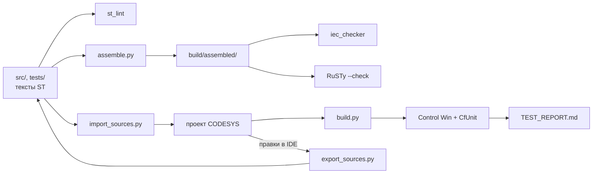

# s7-to-codesys

[](https://github.com/<GITHUB_USER>/s7-to-codesys/actions/workflows/ci.yml)

Шаблон репозитория для ПЛК-проектов на CODESYS V3.5 (3.5.17.30, целевой ПЛК — ОВЕН ПЛК210).
Решает главную проблему ПЛК-кода в git: проект CODESYS (`.project`) бинарный, его нельзя ревьюить
и сливать. Здесь источник истины — текстовые файлы ST, проект собирается из них скриптом, а
проверки (линтер, статанализ, проверка компиляции) идут в CI без CODESYS.

## Демонстрация

> _Плейсхолдер: GIF «импорт → сборка → тесты CfUnit в Control Win» появится после первого
> прогона в CODESYS._

## Архитектура



Подробно — [docs/ARCHITECTURE.md](docs/ARCHITECTURE.md).

## Почему такая раскладка

- **Один объект CODESYS — один файл или папка** (`src/POUs/FB_Example/FB_Example.decl.st`,
  `Reset.method.impl.st`, `Count.get.impl.st`...). Дифф в pull request показывает, какой метод
  изменился, а не «изменился бинарный файл».
- **Объявление и тело — разные файлы**, как в редакторе CODESYS: импорт и экспорт однозначны,
  и цикл «импорт → экспорт» без правок не должен давать диффа (критерий проверки скриптов).
- **Склейка в стандартный ST** (`tools/assemble.py`) позволяет проверять код открытыми
  инструментами — iec_checker и RuSTy — без лицензии и без Windows.
- Контракт раскладки — [docs/LAYOUT.md](docs/LAYOUT.md), правила кода — [CONTRIBUTING.md](CONTRIBUTING.md).

## Быстрый старт без железа

Нужен Python 3.11+ (в CI — 3.12). CODESYS не нужен.

```bash
python -m venv .venv
source .venv/bin/activate              # Windows: .venv\Scripts\activate
python -m pip install -r requirements-dev.txt

python -m pytest                       # тесты инструментов
python tools/check/st_lint.py --strict # правила CONTRIBUTING.md: заголовки, имена, «магические числа»
python tools/assemble.py --tests       # стандартный ST в build/assembled/

# статанализ: бинарник iec_checker v0.4 из релизов (--binary <путь> или переменная IEC_CHECKER)
# или Docker-образ (--docker jubnzv1/iec-checker:nightly)
python tools/check/run_iec_checker.py --binary <путь к iec_checker> --tests
# необязательно: проверка компиляции RuSTy (бинарник plc и stdlib из релиза PLC-lang/rusty v1.0.6)
python tools/check/run_rusty.py --plc <путь к plc> --stdlib <stdlib/include>
```

Отчёты — в `build/` (`iec_checker.md`, `rusty.log`). Опции инструментов — в
[tools/README.md](tools/README.md).

## Импорт в CODESYS и экспорт обратно

Нужны CODESYS 3.5.17.30 и переменные окружения `CODESYS_EXE`, `CODESYS_PROFILE`.

```bat
"%CODESYS_EXE%" --profile="%CODESYS_PROFILE%" --noUI --runscript="tools\codesys\import_sources.py"
"%CODESYS_EXE%" --profile="%CODESYS_PROFILE%" --noUI --runscript="tools\codesys\export_sources.py"
```

Команды уточняются после первого прогона скриптов — актуальная версия, сборка и запуск тестов:
см. [docs/MANUAL_STEPS.md](docs/MANUAL_STEPS.md). Правило: правили в IDE — экспортируйте в `src/`
до коммита.

## Как создать проект из шаблона

1. На GitHub: **Use this template → Create a new repository**.
2. Заменить плейсхолдеры `<ИМЯ ФАМИЛИЯ>` и `<GITHUB_USER>` (LICENSE, README, CONTRIBUTING.md, заголовки ST):
   `git grep -n -e "<ИМЯ ФАМИЛИЯ>" -e "<GITHUB_USER>"`.
3. Удалить пример (`FB_Example`, `ST_Example*`, константы `EXAMPLE_*`) или переименовать под задачу.
4. Обновить `CHANGELOG.md`, `docs/ASSUMPTIONS.md` и `tools/codesys/config.json`.

## Зеркало на GitVerse или GitFlic

```bash
git remote add mirror <url>
git push mirror --all
git push mirror --tags
```

## Тесты и проверки

| Проверка | Где | Что |
|---|---|---|
| ruff, mypy, pytest | CI | код инструментов на Python |
| `st_lint --strict` | CI | раскладка, заголовки POU, табы, длина строки, `TODO` без issue, «магические числа» |
| iec_checker | CI: v0.4 (как локально) — обязательно; образ `nightly` — необязательно | статанализ; находки — в [docs/STATIC_ANALYSIS.md](docs/STATIC_ANALYSIS.md) |
| RuSTy `plc --check` | CI, необязательно | синтаксис и типы собранного ST |
| CfUnit (coUnit 1.2.0.0) | CODESYS Control Win, вручную | юнит-тесты ST; итоги — в [docs/TEST_REPORT.md](docs/TEST_REPORT.md) |

## Документация

- [ARCHITECTURE.md](docs/ARCHITECTURE.md) — схема работы и пример в `src/`
- [LAYOUT.md](docs/LAYOUT.md) — контракт раскладки исходников
- [MANUAL_STEPS.md](docs/MANUAL_STEPS.md) — шаги в IDE CODESYS
- [ASSUMPTIONS.md](docs/ASSUMPTIONS.md) — допущения и решения
- [STATIC_ANALYSIS.md](docs/STATIC_ANALYSIS.md), [TEST_REPORT.md](docs/TEST_REPORT.md),
  [BUILD_ERRORS.md](docs/BUILD_ERRORS.md) — отчёты
- [TZ_template.md](docs/TZ_template.md) (ГОСТ 34.602-2020), [PMI_template.md](docs/PMI_template.md) — шаблоны ТЗ и ПМИ

## Ограничения и дальнейшие шаги

- Импорт, сборка и тесты в CODESYS ещё не прогонялись: «проверено в CODESYS» появится в
  [TEST_REPORT.md](docs/TEST_REPORT.md) только после реального прогона.
- В раскладку не входят визуализации, дерево устройств, конфигураторы обмена, графические языки,
  `ACTION` — это ручные шаги.
- iec_checker и RuSTy понимают не все расширения CODESYS: для них есть упрощённые варианты сборки,
  семантика которых может отличаться.
- Тесты написаны под CfUnit 1.2.0.0 (пространство имён `coUnit`) по исходникам библиотеки, но ещё
  не компилировались; фреймворк не развивается с 2022 года.

## Summary (EN)

A template repository for CODESYS V3.5 (3.5.17.30) PLC projects targeting OWEN PLC210.
The binary `.project` file is not stored in git: plain-text Structured Text files in `src/` and
`tests/` (one CODESYS object per file or folder, see `docs/LAYOUT.md`) are the source of truth.
IronPython scripts for CODESYS Scripting import them into a project and export them back.
`tools/assemble.py` merges the sources into standard IEC 61131-3 ST, so CI on Linux can run a
linter, the iec_checker static analyser and the RuSTy compiler without a CODESYS licence.
Unit tests use CfUnit (coUnit 1.2.0.0) and run in CODESYS Control Win V3. Documentation is in Russian.

## Лицензия

[MIT](LICENSE) © 2026 <ИМЯ ФАМИЛИЯ>
