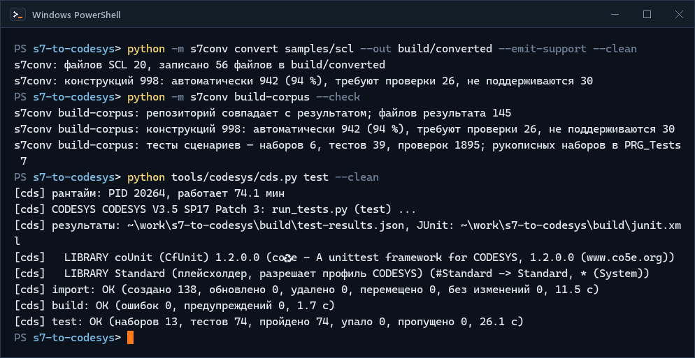
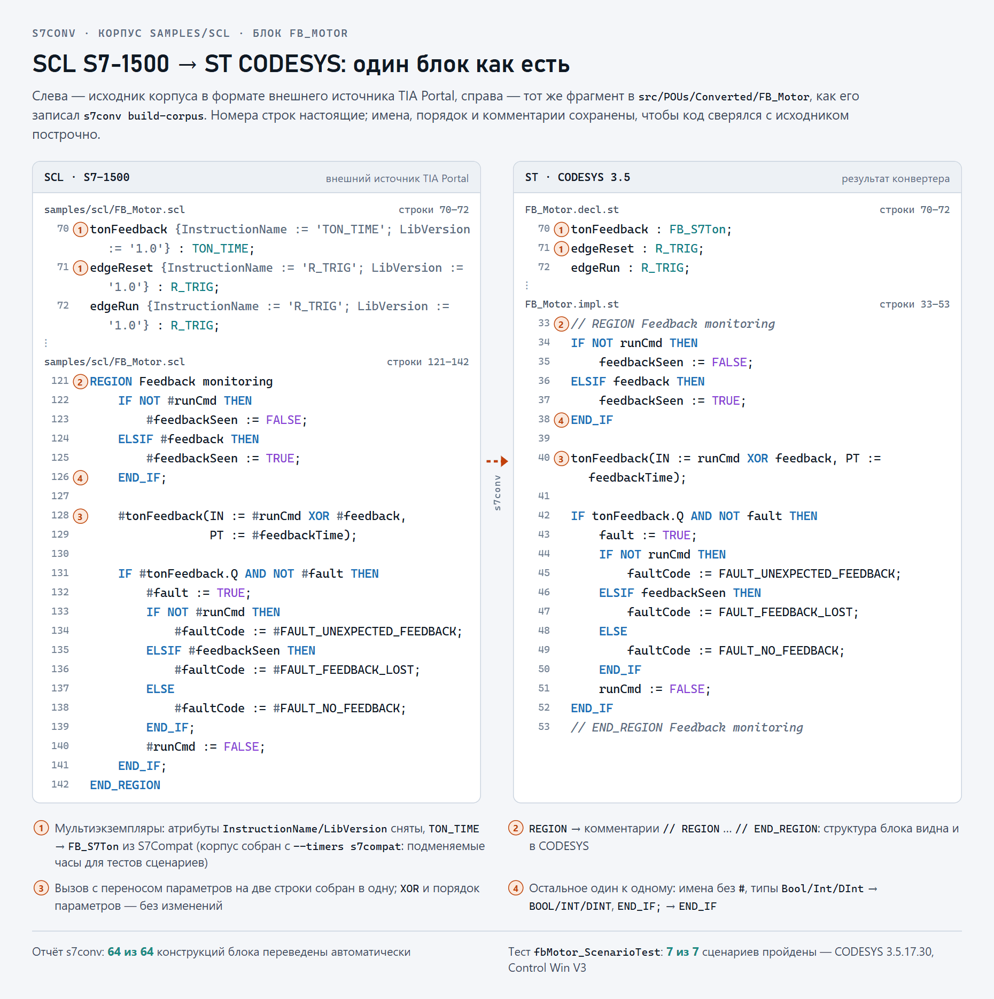
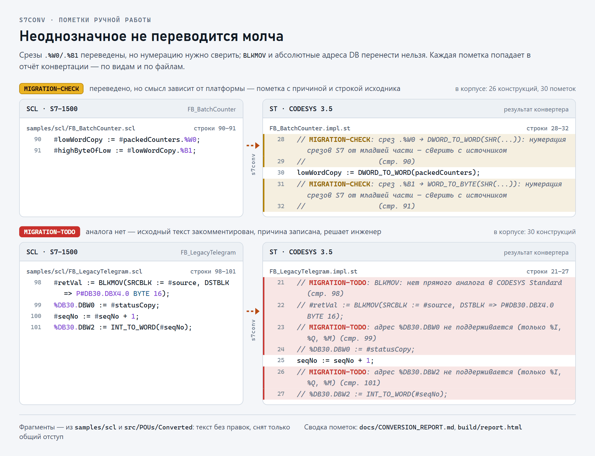
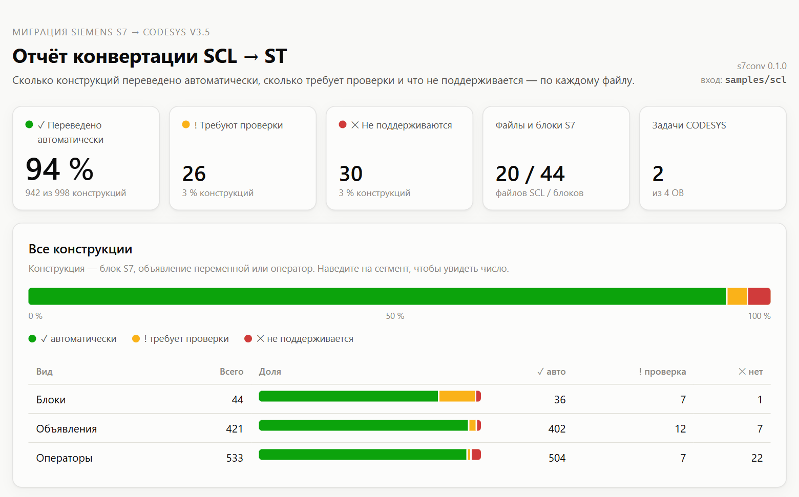
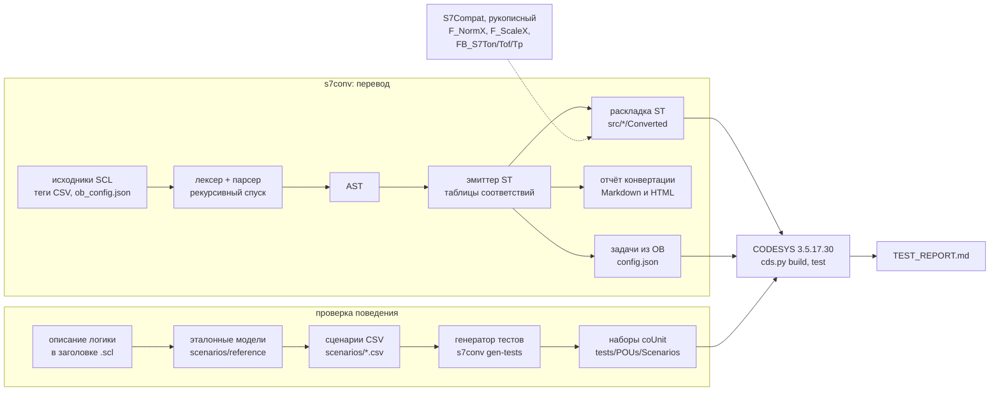

<p align="center">
  <picture>
    <source media="(prefers-color-scheme: dark)" srcset="docs/media/banner-dark.svg">
    <source media="(prefers-color-scheme: light)" srcset="docs/media/banner-light.svg">
    
  </picture>
</p>

<p align="center"><b>Конвертер SCL (Siemens S7, TIA Portal) → Structured Text CODESYS V3.5 с отчётом о ручной работе и тестами поведения</b></p>

<p align="center">
  <a href="https://github.com/kr0nsch/s7-to-codesys/actions/workflows/ci.yml"></a>
  <a href="LICENSE"></a>
  
  <a href="https://github.com/kr0nsch/s7-to-codesys/releases"></a>
  
  
  <a href="#тесты-и-качество"></a>
  
</p>

<p align="center">
  <a href="#что-это-и-зачем">Что это</a> ·
  <a href="#как-это-выглядит">Демо</a> ·
  <a href="#быстрый-старт">Быстрый старт</a> ·
  <a href="#как-использовать-в-своём-проекте">Своя программа</a> ·
  <a href="#как-устроено">Как устроено</a> ·
  <a href="#документация">Документация</a> ·
  <a href="#summary-en">Summary (EN)</a>
</p>

## Что это и зачем

SCL из TIA Portal не компилируется в CODESYS как есть: другие обращения (`#x`, `"DB".тег`) и адреса (`%IW64`
→ `%IW32`), экземплярные DB и OB вместо экземпляров ФБ и задач, инструкции S7 (`TON_TIME`, `NORM_X`). Ручной
перенос сотен блоков долог, а молча потерянная семантика (`F_TRIG`, `RETAIN`, OB100) всплывает на
пусконаладке. `s7conv` переводит SCL в ST CODESYS V3.5, а всё неоднозначное помечает в коде и считает в отчёте.

**Для кого:** инженеры АСУ ТП и интеграторы, которые переводят S7-300/400/1500 на CODESYS V3.5 (в
методике — ОВЕН ПЛК210), и технические руководители, которым нужна оценка ручной работы до начала проекта.

**Что даёт:**

- **Перенос один к одному.** Имена, числа и структура блоков сохраняются: код сверяется с SCL построчно,
  теги HMI и SCADA — по именам. Глобальный DB → GVL с тем же именем, экземплярные DB → `GVL_InstanceDBs`,
  OB → программы и задачи CODESYS, `%I/%Q/%M` → слой ввода-вывода с пересчитанными адресами.
- **Оценка до начала работ.** Отчёт Markdown и HTML по файлам и правилам: на демокорпусе репозитория
  (20 файлов SCL вымышленной водопроводной станции) 94 % конструкций переведены автоматически, 26 требуют
  проверки, 30 не поддерживаются. Как перевести это в часы —
  [методика, раздел 5](docs/methodology.md#5-оценка-трудоёмкости).
- **Ничего не теряется молча.** `// MIGRATION-CHECK: причина` — переведено, но сверить;
  `// MIGRATION-TODO: причина` — аналога нет, исходный текст закомментирован. У каждой пометки — строка
  исходника.
- **Проверка поведения, а не текста.** Из сценариев CSV, посчитанных по описанию логики блока, генератор
  строит юнит-тесты CODESYS на CfUnit (coUnit). В тестах таймеры слоя совместимости S7Compat идут по
  моделируемому времени, поэтому пороги проверяются точно и за один цикл ПЛК.
- **Проект без ручного импорта.** Результат — тексты ST по файлу на объект; `tools/codesys/cds.py`
  собирает из них проект через CODESYS Scripting и прогоняет тесты в CODESYS Control Win. Бинарный
  `.project` в git не хранится.

**Что проверено:** демокорпус (44 блока) собран в CODESYS 3.5.17.30 без ошибок и предупреждений, все 74
теста пройдены в CODESYS Control Win V3. На ПЛК не запускалось ([ограничения](#ограничения-и-планы)).

## Как это выглядит

Всё ниже — с реальных прогонов на машине разработки: `s7conv` на демокорпусе `samples/scl`, CODESYS
3.5.17.30 и CODESYS Control Win V3. Код на картинках — файлы репозитория как есть. Макетов нет.

<p align="center">
  
</p>
<p align="center"><sub>Конвертация демокорпуса → сверка с закоммиченным результатом → тестовый проект CODESYS с нуля и прогон coUnit в Control Win. Реальная сессия 19.10.2026, снято term2gif; ожидание CODESYS (46 с) в записи сокращено</sub></p>

<p align="center">
  <picture>
    <source media="(prefers-color-scheme: dark)" srcset="docs/media/shot-scl-vs-st-dark.png">
    <source media="(prefers-color-scheme: light)" srcset="docs/media/shot-scl-vs-st-light.png">
    
  </picture>
</p>
<p align="center"><sub>Один блок: <code>samples/scl/FB_Motor.scl</code> и <code>src/POUs/Converted/FB_Motor</code> без правок (подсветка и выноски добавлены при отрисовке); его 7 сценариев пройдены в Control Win</sub></p>

<p align="center">
  <picture>
    <source media="(prefers-color-scheme: dark)" srcset="docs/media/shot-migration-marks-dark.png">
    <source media="(prefers-color-scheme: light)" srcset="docs/media/shot-migration-marks-light.png">
    
  </picture>
</p>
<p align="center"><sub>Что конвертер не решает за инженера: <code>MIGRATION-CHECK</code> — переведено, но сверить; <code>MIGRATION-TODO</code> — аналога нет, исходный текст закомментирован</sub></p>

<p align="center">
  <picture>
    <source media="(prefers-color-scheme: dark)" srcset="docs/media/shot-conversion-report-dark.png">
    <source media="(prefers-color-scheme: light)" srcset="docs/media/shot-conversion-report-light.png">
    
  </picture>
</p>
<p align="center"><sub>Верх отчёта <code>s7conv report --html</code> по демокорпусу, снимок страницы в браузере (тёмная и светлая тема отчёта). Разбор по файлам и причинам — в самом отчёте и в <a href="docs/CONVERSION_REPORT.md">CONVERSION_REPORT.md</a></sub></p>

<details>
<summary>Тот же принцип текстом: <code>FB_AnalogIn</code> и <code>FB_LegacyTelegram</code></summary>

SCL (`samples/scl/FB_AnalogIn.scl`):

```text
#rawClamped := LIMIT(MN := #RAW_NOMINAL_LOW, IN := #raw, MX := #RAW_NOMINAL_HIGH);
#normalized := NORM_X(MIN := #RAW_NOMINAL_LOW, VALUE := #rawClamped, MAX := #RAW_NOMINAL_HIGH);
#value := SCALE_X(MIN := #rangeLow, VALUE := #normalized, MAX := #rangeHigh);
```

ST после `s7conv` (`src/POUs/Converted/FB_AnalogIn/FB_AnalogIn.impl.st`) — имена и структура исходника
сохранены, NORM_X/SCALE_X заменены функциями слоя совместимости с той же формулой:

```text
rawClamped := LIMIT(RAW_NOMINAL_LOW, raw, RAW_NOMINAL_HIGH);
normalized := F_NormX(rMin := RAW_NOMINAL_LOW, rValue := rawClamped, rMax := RAW_NOMINAL_HIGH);
value := F_ScaleX(rMin := rangeLow, rValue := normalized, rMax := rangeHigh);
```

То, что перевести нельзя, остаётся закомментированным с причиной (`FB_LegacyTelegram`):

```text
// MIGRATION-TODO: BLKMOV: нет прямого аналога в CODESYS Standard (стр. 98)
// #retVal := BLKMOV(SRCBLK := #source, DSTBLK => P#DB30.DBX4.0 BYTE 16);
```

</details>

## Быстрый старт

### Без CODESYS — любая ОС

Нужны git и Python 3.11+ (в CI — 3.12); конвертеру хватает стандартной библиотеки Python. ПЛК и CODESYS не
нужны.

1. Клонируйте репозиторий:

   ```bat
   git clone https://github.com/kr0nsch/s7-to-codesys.git
   cd s7-to-codesys
   ```

2. Проверьте разбор демокорпуса:

   ```bat
   python -m s7conv check samples/scl
   ```

   Увидите: `s7conv check: файлов 20, блоков 44, без ошибок`.

3. Сконвертируйте его с отчётом:

   ```bat
   python -m s7conv convert samples/scl --out build/converted --emit-support --report-html build/report.html
   ```

   Увидите:

   ```text
   s7conv: файлов SCL 20, записано 56 файлов в build/converted
   s7conv: конструкций 998: автоматически 942 (94 %), требуют проверки 26, не поддерживаются 30
   ```

   В `build/converted/src/{DUTs,GVLs,POUs}` — ST по файлу на объект, в `build/converted/tasks.json` —
   задачи CODESYS из OB, `build/report.html` — отчёт со снимка выше.

4. Убедитесь, что закоммиченный результат воспроизводится:

   ```bat
   python -m s7conv build-corpus --check
   ```

   Увидите: `s7conv build-corpus: репозиторий совпадает с результатом; файлов результата 145` — код в
   `src/*/Converted`, отчёт и тесты сценариев в репозитории получены этой командой, а не правились руками.

Все команды и ключи — `python -m s7conv --help`.

### С CODESYS — Windows

Нужны CODESYS V3.5 SP17 Patch 3 (3.5.17.30) с CODESYS Control Win V3, библиотека coUnit 1.2.0.0 и
переменные окружения `CODESYS_EXE` и `CODESYS_PROFILE` — установка по шагам в
[MANUAL_STEPS.md](docs/MANUAL_STEPS.md#1-установка).

5. Один раз подготовьте пользовательский процесс рантайма (без прав администратора):

   ```bat
   python tools\codesys\cds.py runtime init
   ```

   Увидите три строки о подготовке каталога `%USERPROFILE%\.local\plc-tools\cds-runtime`:

   ```text
   [cds] создан …\cds-runtime\boot.cfg
   [cds] скопирован …\CODESYSControlWinV3\…\CODESYSControl.cfg -> …\cds-runtime\work\CODESYSControl.cfg
   [cds] создан …\cds-runtime\credentials.json (пароль сгенерирован, в вывод не печатается)
   ```

   При повторном запуске — `[cds] каталог рантайма уже подготовлен`. Сам рантайм команда не запускает: его
   запускает `test`.

6. Соберите рабочий проект из `src/` и прогоните тесты в Control Win:

   ```bat
   python tools\codesys\cds.py build
   python tools\codesys\cds.py test
   ```

   Увидите: `build` — проект `build\s7-to-codesys.project`, 0 ошибок и 0 предупреждений; в конце вывода
   `test` — `[cds] test: OK (наборов 13, тестов 74, пройдено 74, упало 0, пропущено 0, …)`. Результаты —
   `build\test-results.json` и `build\junit.xml`.

## Как использовать в своём проекте

Путь от выгрузки TIA Portal до тестов в CODESYS. Команды шагов 2–6 выполняются из корня клона, свои файлы
лежат в нём же, в `my_plc/`; шаг 7 начинается с перехода в каталог над клоном. Подробности, форматы
входных файлов и частые ошибки — [docs/USAGE.md](docs/USAGE.md). Для пробы без своего проекта скопируйте в
`my_plc/scl` четыре файла демокорпуса, а в `my_plc/scenarios` — `scenarios/FB_Motor.csv`
([учебный набор](docs/USAGE.md#учебный-набор)); выводы ниже — с этого набора.

1. **Выгрузите исходники.** В TIA Portal — «Generate source from blocks» для блоков SCL, DB и типов данных
   PLC, файлы — в `my_plc/scl/`; `.db` и `.udt` переименуйте в `.scl` (из каталога читаются только `*.scl`).
   Рядом положите таблицу тегов в CSV (`Name,Path,Data Type,Logical Address,Comment`) и `ob_config.json` —
   номера, виды и периоды OB, которых TIA во внешние источники не пишет (фрагмент
   `samples/scl/ob_config.json`):

   ```json
   {
     "Main": {"number": 1, "kind": "main"},
     "Cyclic interrupt": {"number": 30, "kind": "cyclic", "interval_ms": 100}
   }
   ```

2. **Проверьте разбор:**

   ```bat
   python -m s7conv check my_plc/scl
   ```

   Увидите: `s7conv check: файлов 4, блоков 6, без ошибок`; ошибки выводятся с файлом и строкой.

3. **Оцените объём до работ:**

   ```bat
   python -m s7conv report my_plc/scl --md build/my_plc/report.md --html build/my_plc/report.html
   ```

   Увидите: `s7conv: конструкций 176: автоматически 164 (93 %), требуют проверки 6, не поддерживаются 6`.
   Пути отчёта указывайте всегда: без них `report` пишет в `docs/CONVERSION_REPORT.md` и затрёт отчёт
   демокорпуса.

4. **Сконвертируйте:**

   ```bat
   python -m s7conv convert my_plc/scl --out build/my_plc --folder Converted --timers s7compat --emit-support --report-html build/my_plc/report.html
   ```

   Увидите: `s7conv: файлов SCL 4, записано 19 файлов в build/my_plc`. В `build/my_plc/src` — ST в
   раскладке [docs/LAYOUT.md](docs/LAYOUT.md), в `build/my_plc/tasks.json` — задачи из OB. Ключи
   `--timers s7compat --emit-support` нужны для тестов по сценариям: таймеры S7Compat и их часы попадают в
   результат.

5. **Разберите пометки:**

   ```bat
   findstr /s /n /c:"// MIGRATION-TODO:" build\my_plc\src\*.st
   findstr /s /n /c:"// MIGRATION-CHECK:" build\my_plc\src\*.st
   ```

   В bash — `grep -rn "// MIGRATION-TODO:" build/my_plc/src`. На учебном наборе — по 6 строк каждого вида.
   `MIGRATION-CHECK`: по номеру строки найдите правило в отчёте («Подробно по файлам»), примите одно решение
   на правило и запишите его в [ASSUMPTIONS.md](docs/ASSUMPTIONS.md). `MIGRATION-TODO`: напишите код вручную
   по описанию логики блока; чем заменять — [MAPPING.md](docs/MAPPING.md#не-поддерживается-migration-todo).

6. **Опишите поведение сценариями и сгенерируйте тесты.** На каждый ключевой блок — CSV
   `my_plc/scenarios/<Блок>.csv` с входами по вызовам и ожидаемыми выходами, посчитанными по описанию логики,
   а не по результату конвертера (формат — [scenarios/README.md](scenarios/README.md), пример —
   [USAGE.md, шаг 6](docs/USAGE.md#6-тесты-поведения-по-сценариям)):

   ```bat
   python -m s7conv gen-tests my_plc/scenarios --out build/my_plc/tests --corpus my_plc/scl
   ```

   Увидите: `s7conv gen-tests: наборов 1, тестов 7, проверок 364; рукописных наборов в PRG_Tests 0`.

7. **Соберите и протестируйте в CODESYS.** `cds.py` собирает проект из `src/` и `tests/` корня репозитория,
   поэтому нужна отдельная копия репозитория, в которой демокорпус заменён вашими файлами. Копию кладут
   рядом с первым клоном, а не внутри него, поэтому блок начинается с `cd ..`:

   ```bat
   cd ..
   git clone https://github.com/kr0nsch/s7-to-codesys.git my-migration
   cd my-migration
   git rm -q "samples/scl/*.scl" "samples/scl/*.csv" samples/scl/ob_config.json "scenarios/*.csv"
   copy ..\s7-to-codesys\my_plc\scl\* samples\scl\
   copy ..\s7-to-codesys\my_plc\scenarios\*.csv scenarios\
   python -m s7conv build-corpus
   python tools\codesys\cds.py build
   python tools\codesys\cds.py check --tests
   python tools\codesys\cds.py test
   ```

   Увидите после `build-corpus`: `s7conv build-corpus: записано файлов 4, удалено 114; файлов результата 31`
   и `тесты сценариев — наборов 1, тестов 7, проверок 364`. Код ляжет в `src/*/Converted`, задачи из OB —
   в `tools/codesys/config.json`, тесты — в `tests/POUs/Scenarios`
   ([USAGE.md, шаг 8](docs/USAGE.md#8-сборка-и-тесты-в-codesys)). `build` компилирует только объекты,
   достижимые из задач; если OB во входе нет (как в учебном наборе), задач нет, и весь код компилирует
   `check --tests`. Этот путь проверен до `build-corpus` включительно; сборка и тесты в CODESYS проверены на
   демокорпусе. Тесты pytest, привязанные к демокорпусу, в такой копии падают — их убирают вместе с ним.

Дальше — ручные шаги в IDE (обработчик OB82, Persistent Variables, привязка ввода-вывода к ПЛК210) в
[MANUAL_STEPS.md](docs/MANUAL_STEPS.md#4-что-делается-только-в-ide) и чек-лист миграции в
[methodology.md](docs/methodology.md#4-чек-лист).

## Как устроено

Конвертер пишет тексты ST по файлу на объект CODESYS ([docs/LAYOUT.md](docs/LAYOUT.md)), отчёт и задачи из
OB. `tools/codesys/cds.py` импортирует тексты в проект через CODESYS Scripting, собирает его и запускает
тесты; правки из IDE возвращаются в тексты командой `cds.py export`.



| Каталог | Что внутри |
|---|---|
| `s7conv/` | конвертер на Python: лексер, парсер, эмиттер ST, отчёт, генератор тестов; его тесты pytest |
| `samples/scl/` | демокорпус: 20 файлов SCL вымышленной водопроводной станции (44 блока), таблица тегов, `ob_config.json` |
| `scenarios/` | сценарии CSV для 6 блоков (39 сценариев, 263 вызова) и эталонные модели, по которым посчитаны ожидания |
| `src/*/Converted/` | результат конвертации демокорпуса — генерируется `s7conv build-corpus`, руками не правится |
| `src/*/S7Compat/` | рукописный слой совместимости: `F_NormX`, `F_ScaleX` (формулы NORM_X/SCALE_X), таймеры `FB_S7Ton/Tof/Tp` с подменяемым источником времени (`F_S7Now`, `GVL_S7Clock`), `FB_S7FTrig` с семантикой S7 |
| `tests/POUs/` | тесты CODESYS: `S7Compat` — рукописные, `Scenarios` и `PRG_Tests` — генерируются |
| `tools/` | общие инструменты: сборка ST (`assemble.py`), линтер, iec_checker, RuSTy, `codesys/cds.py` — CODESYS из консоли ([tools/README.md](tools/README.md)) |
| `docs/` | инструкция, методика, таблица соответствий, отчёты |

- **Разбор** — рукописный рекурсивный спуск с восстановлением после ошибок и переносом комментариев
  ([GRAMMAR.md](docs/GRAMMAR.md)); **соответствия** S7 → CODESYS — [MAPPING.md](docs/MAPPING.md).
- **Слой совместимости S7Compat** нужен там, где у CODESYS Standard другая семантика или нет аналога. В
  работе таймеры берут время из `TIME()`, как Standard; тесты ставят часы на момент строки сценария и
  проверяют поведение ровно на пороге таймера. Совпадение со Standard проверяют тесты в реальном времени.

Подробно — [ARCHITECTURE.md](docs/ARCHITECTURE.md); почему тесты идут на моделируемом времени —
[methodology.md](docs/methodology.md#3-проверка-поведения-время-в-тестах), раздел 3.

## Границы автоматизации

Демокорпус `samples/scl/` — 20 файлов, 44 блока (ФБ, FC, OB, глобальные и экземплярные DB, UDT), 998
конструкций ([CONVERSION_REPORT.md](docs/CONVERSION_REPORT.md)):

| Статус | Конструкций | Что в коде |
|---|---:|---|
| переведено автоматически | **942 (94 %)** | ST без замечаний; сюда входят конструкции, переведённые через рукописный S7Compat — его поведение покрыто тестами |
| требует проверки | **26 (3 %)** | ST + `// MIGRATION-CHECK: причина` (30 пометок: у блока OB их бывает несколько) |
| не поддерживается | **30 (3 %)** | `// MIGRATION-TODO: причина` и закомментированный исходный текст |

Доля конструкций — не доля труда: восемь системных функций и OB82 могут потребовать больше работы, чем
сотни автоматически переведённых присваиваний, а расхождения, которые проявляются только во время работы
(разрядность промежуточных результатов, индекс вне границ, деление REAL на 0), конвертер не помечает вовсе —
они в чек-листе ([methodology.md](docs/methodology.md#5-оценка-трудоёмкости), «Оценка трудоёмкости»;
[MAPPING.md](docs/MAPPING.md#расхождения-которые-конвертер-не-помечает)).

<details>
<summary>Что именно не поддерживается и что требует проверки на демокорпусе</summary>

**Не поддерживается (30)** — то, что требует решения инженера, а не замены текста:

| Категория | Пометок |
|---|---:|
| системные функции без аналога в Standard: `RD_SYS_T`, `WR_SYS_T`, `RUNTIME`, `PEEK`, `POKE`, `BLKMOV`, `S_ODT`, `TypeOf` | 8 |
| типы без аналога: `Any` (2), `Variant`, `DTL`, `HW_ANY` | 5 |
| наложения `AT` (2), абсолютные адреса DB `%DB30.DBW0/2` (2), доступ к периферии `:P` (1) | 5 |
| `GOTO` и метки переходов | 4 |
| следствия неперенесённых объявлений: использование переменной (4), аргумент вызова (2) | 6 |
| `EN/ENO` | 1 |
| событийный OB82 — задача по событию | 1 |

16 из 30 приходятся на `FB_LegacyTelegram`: блок нарочно собран из конструкций STEP 7 V5.x, которые
автоматически не переносятся (`ANY`-указатель, `AT`, `BLKMOV`, абсолютная и косвенная адресация DB, `S_ODT`,
`GOTO`), и его заголовок описывает логику для ручного переноса.

**Требует проверки (26 конструкций, 30 пометок)** — переведено, но смысл зависит от платформы или проекта:
S5TIME → TIME (7), стартовая информация OB, `Initial_Call` и OB100 → флаг первого цикла (7), начальное
состояние `F_TRIG` (5 — у Standard 3.5.17.0 проверено, совпадает с S7; пометка остаётся для других версий
библиотеки), нумерация срезов `.%B/.%W` (3), неоптимизированные блоки и их реманентность (3),
переименование имён-ключевых слов (2), разные типы — `CTU` с `WORD` и `SCALE_X` с целым результатом (2),
`VAR RETAIN` в ФБ — весь экземпляр (1).

</details>

## Тесты и качество

Что проверено в настоящем CODESYS, а что — без него. На ПЛК (ОВЕН ПЛК210) код не запускался.

**CODESYS 3.5.17.30 + CODESYS Control Win V3** (локально, Windows): все команды — 2026-10-16, повторено с
чистого `build/` ([TEST_REPORT.md](docs/TEST_REPORT.md#сборка-и-прогон-в-codesys-2026-10-16)); перед выпуском
1.0.0, 2026-10-19, — `check --tests` и `test --clean`
([TEST_REPORT.md](docs/TEST_REPORT.md#повторный-прогон-перед-выпуском-2026-10-19),
[STATIC_ANALYSIS.md](docs/STATIC_ANALYSIS.md#последний-прогон)):

| Команда `python tools/codesys/cds.py …` | Итог |
|---|---|
| `build` — рабочий проект: демокорпус, S7Compat, задачи из OB | ошибок 0, предупреждений 0 |
| `library` — «Проверить все объекты пула» (39 объектов, в том числе OB82 без задачи) | ошибок 0, предупреждений 0 |
| `check --tests` — все 54 объекта `src/` и `tests/`, в том числе без вызовов | ошибок 0, предупреждений 0 |
| `build --tests` — тестовый проект с coUnit 1.2.0.0 | ошибок 0, предупреждений 0 |
| `test` — загрузка в Control Win, `TestTask` 10 мс | 13 наборов, 74 теста: **пройдено 74**, упало 0; все наборы завершились за 1,2 с |
| `roundtrip` — импорт → экспорт → сравнение | 242 файла совпадают побайтно; повторный импорт — 0 изменений |

<details>
<summary>Почему этим числам можно верить: контрольные эксперименты</summary>

- Тесты не пустые: искажённые ожидания в CSV (в том числе в строке ровно на пороге таймера) CODESYS ловит
  ровно теми тестами и сообщениями; ошибка, внесённая в OB82 без задачи, видна в `library`, хотя `build`
  её не компилирует (TEST_REPORT.md, «Повторная проверка с чистого `build/`»).
- «0 предупреждений» значит, что неявных преобразований нет: смена знака дала бы предупреждение C0195, а
  неявное сужение в 3.5.17 — ошибку C0032 ([STATIC_ANALYSIS.md](docs/STATIC_ANALYSIS.md#компилятор-codesys)).
- Прогон `cds.py test --clean` (тестовый проект с нуля, импорт 138 объектов) снят в GIF раздела
  [«Как это выглядит»](#как-это-выглядит).
- Интерпретатор ST в тестах конвертера (`stsim`) и CODESYS дали одинаковый итог по всем 39 сценариям;
  окончательный результат — прогон в Control Win.

</details>

**Без CODESYS** (CI на каждый push и локально):

| Проверка | Итог |
|---|---|
| ruff, `ruff format --check`, mypy (strict, 63 файла) | без замечаний |
| pytest (около минуты) | 1030 тестов: разбор, эмиттер, генератор тестов, снапшоты фикстур и корпуса, RuSTy и iec_checker по всему `src/` и `tests/` (если инструмент установлен), интерпретатор ST `stsim` — те же наборы coUnit против сконвертированного кода и мутации логики |
| `s7conv build-corpus --check`, `gen-tests --check` | сгенерированное совпадает с конвертером побайтно |
| `st_lint --strict` | 242 файла, 0 замечаний |
| iec_checker 0.4 (`run_iec_checker.py --tests`) | `ParserError` 0, необоснованных находок 0; обоснования — в STATIC_ANALYSIS.md |
| RuSTy 1.0.6 `plc --check` (необязательно) | 51 файл, 0 ошибок (3 исключены с причинами) |

<details>
<summary>Как запустить эти проверки локально</summary>

```bat
python -m pip install -r requirements-dev.txt
python -m ruff check .
python -m ruff format --check .
python -m mypy
python -m pytest
python tools/check/st_lint.py --strict
python tools/check/run_iec_checker.py --tests
python tools/check/run_rusty.py --optional
```

iec_checker v0.4 — бинарник со страницы релизов
[iec-checker/iec-checker](https://github.com/iec-checker/iec-checker/releases) (`iec_checker_Windows_x86_64.exe`
или `iec_checker_Linux_x86_64`): в `PATH`, в переменной `IEC_CHECKER` или ключом `--binary`; без него
`run_iec_checker.py --tests --optional` выдаст предупреждение и код 0. RuSTy (`plc`) с `--optional` тоже
пропускается, если не установлен ([tools/README.md](tools/README.md)).

</details>

## Документация

| Вопрос | Документ |
|---|---|
| Как сконвертировать свои исходники: шаги, ключи, пометки, тесты, CODESYS | [docs/USAGE.md](docs/USAGE.md) |
| Как подготовить входные файлы (таблица тегов, `ob_config.json`) и что в демокорпусе | [samples/scl/README.md](samples/scl/README.md) |
| Что во что переводится и почему; что не поддерживается и чем заменить | [docs/MAPPING.md](docs/MAPPING.md) |
| Какое подмножество SCL разбирается | [docs/GRAMMAR.md](docs/GRAMMAR.md) |
| Что получилось на демокорпусе — по файлам и правилам | [docs/CONVERSION_REPORT.md](docs/CONVERSION_REPORT.md) |
| Как писать сценарии CSV и откуда берутся ожидаемые значения | [scenarios/README.md](scenarios/README.md) |
| Как вести миграцию: этапы, риски, чек-лист, оценка трудоёмкости, выбор способа тестирования | [docs/methodology.md](docs/methodology.md) |
| Что делать в IDE: установка, проект для ПЛК210, OB82, Persistent Variables, ввод-вывод | [docs/MANUAL_STEPS.md](docs/MANUAL_STEPS.md) |
| Как запускать CODESYS из консоли: команды `cds.py`, переменные окружения | [tools/README.md](tools/README.md) |
| Как устроен проект и раскладка ST | [docs/ARCHITECTURE.md](docs/ARCHITECTURE.md), [docs/LAYOUT.md](docs/LAYOUT.md) |
| Что прошло в CODESYS и в статанализе; куда записывать ошибки сборки из IDE | [docs/TEST_REPORT.md](docs/TEST_REPORT.md), [docs/STATIC_ANALYSIS.md](docs/STATIC_ANALYSIS.md), [docs/BUILD_ERRORS.md](docs/BUILD_ERRORS.md) |
| Какие допущения приняты и что из них подтверждено | [docs/ASSUMPTIONS.md](docs/ASSUMPTIONS.md) |
| Шаблоны ТЗ и ПМИ для проекта миграции | [docs/TZ_template.md](docs/TZ_template.md), [docs/PMI_template.md](docs/PMI_template.md) |
| Правила кода и сопровождения; история версий | [CONTRIBUTING.md](CONTRIBUTING.md), [CHANGELOG.md](CHANGELOG.md) |

## Ограничения и планы

- **Проверено в CODESYS 3.5.17.30 и Control Win V3, а не на ПЛК210.** На ПЛК210 (свой таргет-файл и
  версия Standard) прогон нужно повторить; тест `StandardFTrigMatchesS7` покажет, совпадает ли там `F_TRIG`
  с S7.
- Разбирается только SCL: блоки LAD/FBD/STL сначала переводят в SCL в TIA Portal или вручную. Из каталога
  читаются только файлы `*.scl` — выгрузку `.db` и `.udt` переименовывают.
- Демокорпус написан по формату внешних источников TIA Portal V15–V18 и в TIA не компилировался; эталон
  поведения — описание логики блоков и модели, а не прогон на S7.
- Не создаются автоматически: задача или обработчик для OB82, объект Persistent Variables, привязка
  каналов ПЛК210 — пошагово в [MANUAL_STEPS.md](docs/MANUAL_STEPS.md), раздел 4. Слой ввода-вывода
  `GVL_IO` — заготовка с пересчитанными адресами.
- OB100 эмулируется флагом первого цикла, который команда Stop → Start CODESYS не сбрасывает (в S7 OB100
  выполняется при каждом STOP → RUN).
- `s7conv` работает из клона репозитория (общий модуль раскладки и S7Compat берутся оттуда), а не как
  отдельный пакет. Сборка своего проекта в CODESYS идёт через копию репозитория с заменой демокорпуса;
  этот путь проверен до `build-corpus`, тесты демокорпуса в копии нужно убрать
  ([USAGE.md, шаг 8](docs/USAGE.md#8-сборка-и-тесты-в-codesys)).
- Версия конвертера — 0.1.0 (`s7conv --version`, заголовки сгенерированных файлов), версия репозитория —
  1.0.0 ([CHANGELOG.md](CHANGELOG.md)).
- Дальше: прогон на ПЛК210 со стендовой проверкой retain и ввода-вывода; импорт демокорпуса в TIA Portal,
  чтобы подтвердить формат выгрузки.

## Связанные проекты

- [plc-repo-template](https://github.com/kr0nsch/plc-repo-template) — шаблон, из которого взяты раскладка ST и
  инструменты `tools/` (сборка, линтер, статанализ, `cds.py`); общие инструменты синхронизированы с ним.
- [plc-ci-toolkit](https://github.com/kr0nsch/plc-ci-toolkit) — переиспользуемые workflow CI для
  репозиториев на этом шаблоне; [plc-process-lib](https://github.com/kr0nsch/plc-process-lib) — библиотека ФБ
  устройств для той же платформы (CODESYS 3.5.17.30, ОВЕН ПЛК210).
- Остальные проекты серии — в таблице ниже; неопубликованные помечены «готовится».

## Summary (EN)

s7-to-codesys converts Siemens S7 SCL sources exported from TIA Portal into CODESYS V3.5 Structured Text
and reports what still needs an engineer. Names and structure are kept one-to-one. On the 20-file demo
corpus (44 blocks, 998 constructs) 94 % convert automatically, 26 constructs need review (`MIGRATION-CHECK`)
and 30 are unsupported (`MIGRATION-TODO`: system functions, ANY/Variant, AT, GOTO, event OBs); each is marked
in the code with a reason and counted in a per-file report. Behaviour is checked by coUnit tests generated
from CSV scenarios based on block descriptions, not on converter output: the corpus compiles in CODESYS
3.5.17.30 with 0 errors and 0 warnings, all 74 tests pass in Control Win V3; not yet run on PLC hardware. Own
sources: `python -m s7conv convert <scl-dir> --out <dir>`, guide in docs/USAGE.md. Documentation is in Russian.

## Лицензия

[MIT](LICENSE) © 2026 kr0nsch

---

<p align="center"><b>Портфолио АСУ ТП</b></p>
<table>
<tr><td width="33%"><a href="https://github.com/kr0nsch/plc-repo-template">01 · plc-repo-template</a><br><sub>ST в git, сборка проекта скриптом, CI</sub></td><td width="33%"><a href="https://github.com/kr0nsch/plc-process-lib">02 · plc-process-lib</a><br><sub>ФБ: AI, двигатель, ПЧ, задвижка, ПИД, тревоги</sub></td><td width="33%"><span data-repo="kns-pump-station">03 · kns-pump-station</span> <sub>(готовится)</sub><br><sub>флагман: КНС, три насоса с ПЧ, модель, HMI</sub></td></tr>
<tr><td width="33%"><a href="https://github.com/kr0nsch/kns-port-domestic">04 · kns-port-domestic</a><br><sub>перенос на Astra.IDE / MasterSCADA 4D</sub></td><td width="33%"><a href="https://github.com/kr0nsch/plc-iiot-stack">05 · plc-iiot-stack</a><br><sub>OPC UA / MQTT → InfluxDB → Grafana</sub></td><td width="33%"><a href="https://github.com/kr0nsch/iolistgen">06 · iolistgen</a><br><sub>перечень сигналов → ST, карты Modbus, SCADA</sub></td></tr>
<tr><td width="33%"><a href="https://github.com/kr0nsch/plc-ci-toolkit">07 · plc-ci-toolkit</a><br><sub>линтеры, сборка CODESYS, тесты, JUnit</sub></td><td width="33%"><a href="https://github.com/kr0nsch/s7-to-codesys"><b>08 · s7-to-codesys</b></a><br><sub>конвертер SCL → ST с отчётом о переносе</sub></td><td width="33%"><a href="https://github.com/kr0nsch/sis-interlock-demo">09 · sis-interlock-demo</a><br><sub>ПАЗ: MooN, матрица причин и следствий</sub></td></tr>
</table>
