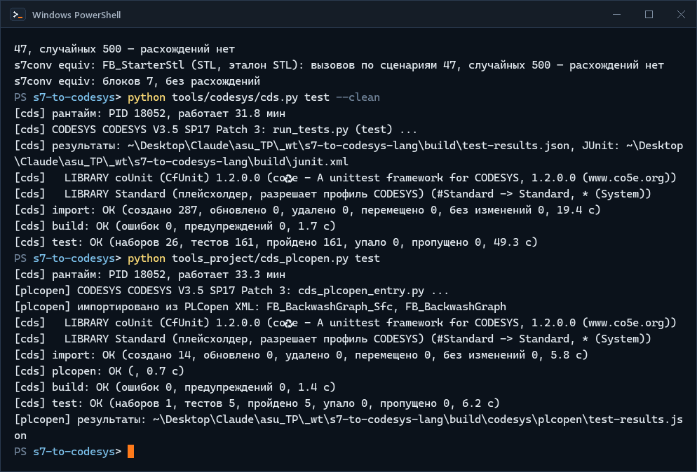
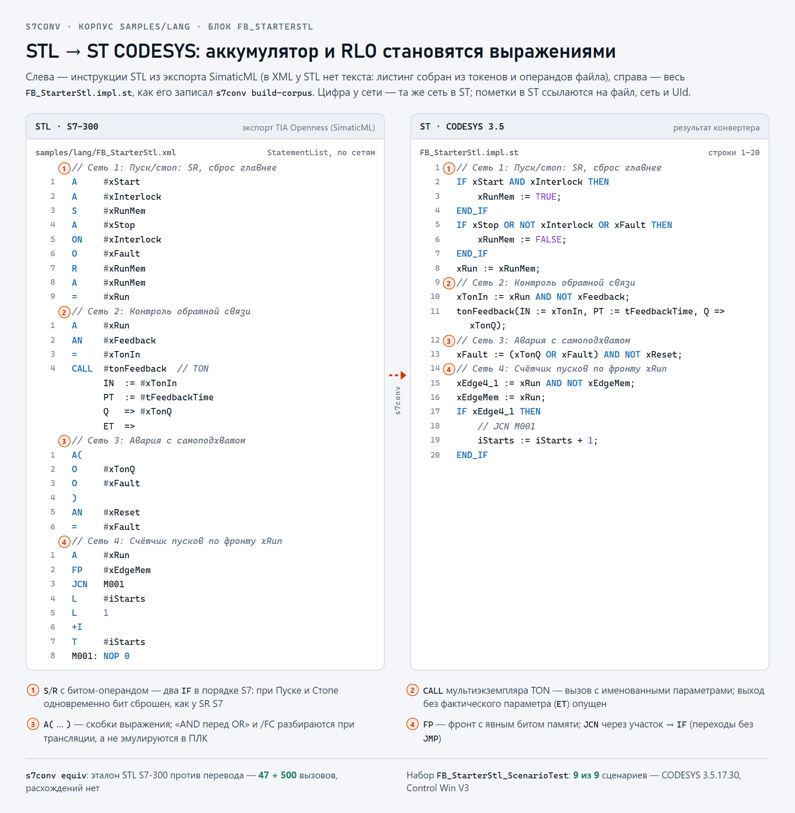
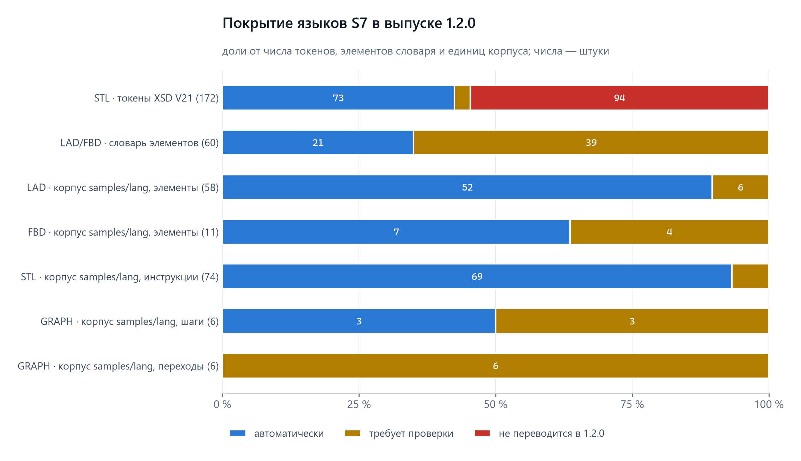
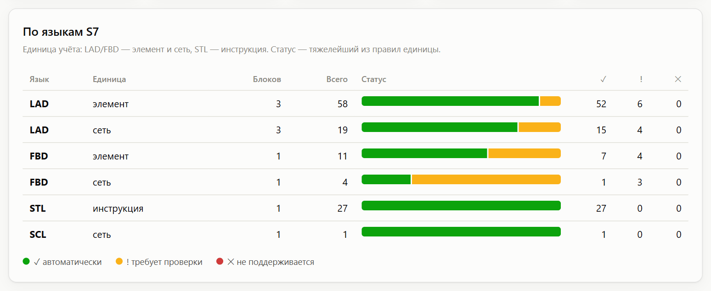
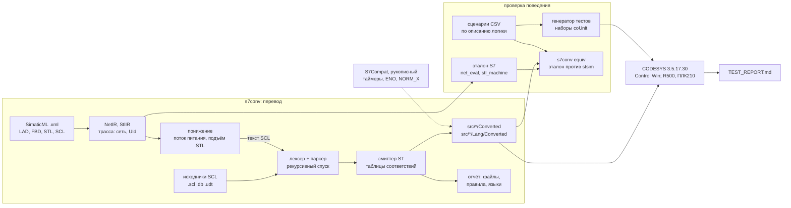

<p align="center">
  <picture>
    <source media="(prefers-color-scheme: dark)" srcset="docs/media/banner-dark.svg">
    <source media="(prefers-color-scheme: light)" srcset="docs/media/banner-light.svg">
    
  </picture>
</p>

<p align="center"><b>Конвертер Siemens S7 (SCL, LAD, FBD, STL) → CODESYS V3.5 с отчётом о ручной работе и проверкой поведения</b></p>

<p align="center">
  <a href="https://github.com/kr0nsch/s7-to-codesys/actions/workflows/ci.yml"></a>
  <a href="LICENSE"></a>
  
  <a href="https://github.com/kr0nsch/s7-to-codesys/releases"></a>
  
  
  <a href="#тесты-и-качество"></a>
  
</p>

<p align="center">
  <a href="#что-это-и-зачем">Что это</a> ·
  <a href="#как-это-выглядит">Демо</a> ·
  <a href="#быстрый-старт">Быстрый старт</a> ·
  <a href="#как-использовать-в-своём-проекте">Своя программа</a> ·
  <a href="#границы-автоматизации">Границы</a> ·
  <a href="#тесты-и-качество">Тесты</a> ·
  <a href="#документация">Документация</a> ·
  <a href="#summary-en">Summary (EN)</a>
</p>

## Что это и зачем

Проекты на Siemens S7 в России переносят на ОВЕН ПЛК210/СПК (CODESYS V3.5 SP17) и REGUL (Astra.IDE —
OEM-сборка CODESYS 3.5.17). Код S7 там не компилируется как есть: другие обращения и адреса, экземплярные DB
и OB вместо экземпляров ФБ и задач, инструкции S7, а LAD, FBD и STL вообще не переносятся текстом. Ручной
перенос сотен блоков долог, а молча потерянная семантика (приоритет SR, ENO, `F_TRIG`, OB100) всплывает на
пусконаладке. `s7conv` переводит SCL и экспорт LAD, FBD, STL из TIA Portal в ST CODESYS V3.5, а всё
неоднозначное помечает в коде и считает в отчёте.

**Для кого:** инженеры АСУ ТП и интеграторы, которые переводят S7-300/400/1500 на CODESYS V3.5, и технические
руководители, которым нужна оценка ручной работы до начала проекта.

**Что даёт:**

- **Четыре языка — один ST.** SCL (`.scl`, `.db`, `.udt`) и сети LAD, FBD, STL, SCL из экспорта SimaticML
  (`.xml`) переводятся в читаемый ST: поток питания — в булевы выражения, STL — в выражения вместо эмуляции
  аккумулятора, переходы — в `IF`/`CASE` без `JMP`. Пометка в ST ссылается на файл, сеть и UId элемента.
- **Перенос один к одному.** Имена, числа и структура блоков сохраняются: код сверяется с исходником
  построчно и по сетям, теги HMI и SCADA — по именам. OB → программы и задачи CODESYS, DB → GVL.
- **Оценка до начала работ.** Отчёт Markdown и HTML по файлам, правилам и языкам: на демокорпусе SCL
  (20 файлов) 94 % конструкций переведены автоматически, на корпусе всех языков (8 файлов) — 95 %.
- **Ничего не теряется молча.** `// MIGRATION-CHECK: причина` — переведено, но сверить;
  `// MIGRATION-TODO: причина` — аналога нет, исходный текст закомментирован.
- **Проверка поведения, а не текста.** Тесты CODESYS на CfUnit (coUnit) генерируются из сценариев CSV,
  посчитанных по описанию логики блока; `s7conv equiv` дополнительно сверяет перевод LAD, FBD и STL с эталоном
  S7 на сценариях и случайных входах.
- **Проект без ручного импорта.** `tools/codesys/cds.py` собирает проект CODESYS из текстов ST и прогоняет
  тесты в CODESYS Control Win; бинарный `.project` в git не хранится.

**Что проверено:** оба корпуса собраны в CODESYS 3.5.17.30 без ошибок и предупреждений, 128 тестов из 128
пройдены в CODESYS Control Win V3; `src/` компилируется под устройства REGUL R500 (Astra.IDE 1.7.2.2) и ОВЕН
ПЛК210 без ошибок и предупреждений. На ПЛК код не запускался ([ограничения](#ограничения-и-планы)).

## Как это выглядит

Всё ниже — с реальных прогонов на машине разработки: `s7conv` на корпусах `samples/lang` и `samples/scl`,
CODESYS 3.5.17.30 и CODESYS Control Win V3. Код на картинках — файлы репозитория как есть. Макетов нет.

<p align="center">
  
</p>
<p align="center"><sub>Корпус всех языков: разбор → конвертация → эталон S7 против перевода → тестовый проект CODESYS с нуля и прогон coUnit в Control Win. Реальная сессия 20.10.2026, снято term2gif; ожидание CODESYS (66 с) в записи сокращено</sub></p>

<p align="center">
  <picture>
    <source media="(prefers-color-scheme: dark)" srcset="docs/media/shot-stl-trace-dark.png">
    <source media="(prefers-color-scheme: light)" srcset="docs/media/shot-stl-trace-light.png">
    
  </picture>
</p>
<p align="center"><sub>Один блок STL: листинг собран из токенов <code>samples/lang/FB_StarterStl.xml</code>, справа — <code>src/POUs/Lang/Converted/FB_StarterStl</code> без правок (подсветка и выноски добавлены при отрисовке); итоги equiv и coUnit внизу — из прогонов</sub></p>

<p align="center">
  <picture>
    <source media="(prefers-color-scheme: dark)" srcset="docs/media/chart-lang-coverage-dark.png">
    <source media="(prefers-color-scheme: light)" srcset="docs/media/chart-lang-coverage-light.png">
    
  </picture>
</p>
<p align="center"><sub>Сколько языка покрыто: из справочников <a href="docs/MAPPING_STL.md">MAPPING_STL.md</a> и <a href="docs/MAPPING_LADFBD.md">MAPPING_LADFBD.md</a> и отчёта <a href="docs/CONVERSION_REPORT_LANG.md">CONVERSION_REPORT_LANG.md</a> (сгенерированы конвертером)</sub></p>

<p align="center">
  <picture>
    <source media="(prefers-color-scheme: dark)" srcset="docs/media/shot-report-languages-dark.png">
    <source media="(prefers-color-scheme: light)" srcset="docs/media/shot-report-languages-light.png">
    
  </picture>
</p>
<p align="center"><sub>Раздел «По языкам» отчёта <code>build/report-lang.html</code> (пишет <code>s7conv build-corpus</code>), снимок страницы в браузере</sub></p>

<details>
<summary>Корпус SCL: исходник рядом с ST, пометки ручной работы, отчёт, GIF выпуска 1.0.0</summary>

<p align="center">
  <picture>
    <source media="(prefers-color-scheme: dark)" srcset="docs/media/shot-scl-vs-st-dark.png">
    <source media="(prefers-color-scheme: light)" srcset="docs/media/shot-scl-vs-st-light.png">
    
  </picture>
</p>
<p align="center"><sub>Один блок SCL: <code>samples/scl/FB_Motor.scl</code> и <code>src/POUs/Converted/FB_Motor</code> без правок; его 7 сценариев пройдены в Control Win</sub></p>

<p align="center">
  <picture>
    <source media="(prefers-color-scheme: dark)" srcset="docs/media/shot-migration-marks-dark.png">
    <source media="(prefers-color-scheme: light)" srcset="docs/media/shot-migration-marks-light.png">
    
  </picture>
</p>
<p align="center"><sub>Что конвертер не решает за инженера: <code>MIGRATION-CHECK</code> — переведено, но сверить; <code>MIGRATION-TODO</code> — аналога нет, исходный текст закомментирован</sub></p>

<p align="center">
  <picture>
    <source media="(prefers-color-scheme: dark)" srcset="docs/media/shot-conversion-report-dark.png">
    <source media="(prefers-color-scheme: light)" srcset="docs/media/shot-conversion-report-light.png">
    
  </picture>
</p>
<p align="center"><sub>Верх отчёта <code>s7conv report --html</code> по демокорпусу SCL; разбор по файлам и причинам — в <a href="docs/CONVERSION_REPORT.md">CONVERSION_REPORT.md</a></sub></p>

<p align="center">
  
</p>
<p align="center"><sub>Сессия 19.10.2026 (выпуск 1.0.0, только корпус SCL); ожидание CODESYS (46 с) в записи сокращено</sub></p>

</details>

## Быстрый старт

### Без CODESYS — любая ОС

Нужны git и Python 3.11+ (в CI — 3.12); конвертеру хватает стандартной библиотеки Python. ПЛК и CODESYS не
нужны.

1. Клонируйте репозиторий:

   ```bat
   git clone https://github.com/kr0nsch/s7-to-codesys.git
   cd s7-to-codesys
   ```

2. Проверьте разбор обоих корпусов — SCL и экспорта SimaticML (LAD, FBD, STL, SCL):

   ```bat
   python -m s7conv check samples/scl samples/lang
   ```

   Увидите: `s7conv check: файлов 28, блоков 52, без ошибок`.

3. Сконвертируйте блоки LAD, FBD и STL:

   ```bat
   python -m s7conv convert samples/lang --out build/lang --timers s7compat --emit-support --clean
   ```

   Увидите:

   ```text
   s7conv: файлов SCL 0, SimaticML 8, записано 22 файлов в build/lang
   s7conv: конструкций 173: автоматически 164 (95 %), требуют проверки 9, не поддерживаются 0
   ```

   В `build/lang/src/POUs/FB_StarterLad`, `FB_StarterFbd`, `FB_StarterStl` — один и тот же пускатель,
   переведённый с трёх языков.

4. Сверьте перевод с эталоном S7 на сценариях и 500 случайных вызовах на блок:

   ```bat
   python -m s7conv equiv samples/lang --scenarios scenarios/lang --random 500
   ```

   Увидите по строке на блок и итог `s7conv equiv: блоков 5, без расхождений`.

5. Сконвертируйте корпус SCL с отчётом:

   ```bat
   python -m s7conv convert samples/scl --out build/converted --emit-support --report-html build/report.html
   ```

   Увидите:

   ```text
   s7conv: файлов SCL 20, записано 56 файлов в build/converted
   s7conv: конструкций 998: автоматически 942 (94 %), требуют проверки 26, не поддерживаются 30
   ```

6. Убедитесь, что закоммиченный результат воспроизводится:

   ```bat
   python -m s7conv build-corpus --check
   ```

   Увидите первой строкой `s7conv build-corpus: репозиторий совпадает с результатом; файлов результата 254`
   — код в `src/*/Converted` и `src/*/Lang/Converted`, отчёты и тесты сценариев получены этой командой, а не
   правились руками.

Все команды и ключи — `python -m s7conv --help`.

### С CODESYS — Windows

Нужны CODESYS V3.5 SP17 Patch 3 (3.5.17.30) с CODESYS Control Win V3, библиотека coUnit 1.2.0.0 и
переменные окружения `CODESYS_EXE` и `CODESYS_PROFILE` — установка по шагам в
[MANUAL_STEPS.md](docs/MANUAL_STEPS.md#1-установка).

7. Один раз подготовьте пользовательский процесс рантайма (без прав администратора):

   ```bat
   python tools\codesys\cds.py runtime init
   ```

   Увидите три строки о подготовке каталога `%USERPROFILE%\.local\plc-tools\cds-runtime`:

   ```text
   [cds] создан …\cds-runtime\boot.cfg
   [cds] скопирован …\CODESYSControlWinV3\…\CODESYSControl.cfg -> …\cds-runtime\work\CODESYSControl.cfg
   [cds] создан …\cds-runtime\credentials.json (пароль сгенерирован, в вывод не печатается)
   ```

   При повторном запуске — `[cds] каталог рантайма уже подготовлен`. Сам рантайм команда не запускает: его
   запускает `test`.

8. Соберите рабочий проект из `src/` и прогоните тесты в Control Win:

   ```bat
   python tools\codesys\cds.py build
   python tools\codesys\cds.py test
   ```

   Увидите: `build` — проект `build\s7-to-codesys.project`, 0 ошибок и 0 предупреждений; в конце вывода
   `test` — `[cds] test: OK (наборов 21, тестов 128, пройдено 128, упало 0, пропущено 0, …)`. Результаты —
   `build\test-results.json` и `build\junit.xml`.

Компиляция под REGUL R500 (Astra.IDE) и ПЛК210 — те же команды с другим `CODESYS_EXE` и устройством в
переменных `CDS_DEVICE_*` ([MANUAL_STEPS.md, 3.1](docs/MANUAL_STEPS.md#31-компиляция-под-regul-r500-и-овен-плк210)).

## Как использовать в своём проекте

Путь от выгрузки TIA Portal до тестов в CODESYS. Команды шагов 2–6 выполняются из корня клона, свои файлы
лежат в нём же, в `my_plc/`; шаг 7 начинается с перехода в каталог над клоном. Подробности, форматы
входных файлов и частые ошибки — [docs/USAGE.md](docs/USAGE.md). Для пробы без своего проекта скопируйте в
`my_plc/scl` четыре файла демокорпуса, а в `my_plc/scenarios` — `scenarios/FB_Motor.csv`
([учебный набор](docs/USAGE.md#учебный-набор)); выводы ниже — с этого набора.

1. **Выгрузите исходники.** SCL, DB и типы данных PLC — «Generate source from blocks», файлы — в
   `my_plc/scl/` (читаются `*.scl`, `*.db` и `*.udt`). Блоки LAD, FBD и STL текстом не выгружаются — для
   них нужен XML-экспорт TIA Portal Openness (SimaticML, метод `Export` блока, скриптом или надстройкой);
   файлы `*.xml` кладите туда же ([USAGE.md](docs/USAGE.md#блоки-lad-fbd-и-stl-экспорт-simaticml)).
   Рядом положите таблицу тегов в CSV (`Name,Path,Data Type,Logical Address,Comment`) и `ob_config.json` —
   номера, виды и периоды OB, которых TIA во внешние источники не пишет (фрагмент
   `samples/scl/ob_config.json`):

   ```json
   {
     "Main": {"number": 1, "kind": "main"},
     "Cyclic interrupt": {"number": 30, "kind": "cyclic", "interval_ms": 100}
   }
   ```

2. **Проверьте разбор:**

   ```bat
   python -m s7conv check my_plc/scl
   ```

   Увидите: `s7conv check: файлов 4, блоков 6, без ошибок`; ошибки выводятся с файлом и строкой.

3. **Оцените объём до работ:**

   ```bat
   python -m s7conv report my_plc/scl --md build/my_plc/report.md --html build/my_plc/report.html
   ```

   Увидите: `s7conv: конструкций 176: автоматически 164 (93 %), требуют проверки 6, не поддерживаются 6`.
   Пути отчёта указывайте всегда: без них `report` пишет в `docs/CONVERSION_REPORT.md` и затрёт отчёт
   демокорпуса. Для блоков из SimaticML в отчёте есть раздел «По языкам».

4. **Сконвертируйте:**

   ```bat
   python -m s7conv convert my_plc/scl --out build/my_plc --folder Converted --timers s7compat --emit-support --report-html build/my_plc/report.html
   ```

   Увидите: `s7conv: файлов SCL 4, записано 19 файлов в build/my_plc`. В `build/my_plc/src` — ST в
   раскладке [docs/LAYOUT.md](docs/LAYOUT.md), в `build/my_plc/tasks.json` — задачи из OB. Ключи
   `--timers s7compat --emit-support` нужны для тестов по сценариям: таймеры S7Compat и их часы попадают в
   результат. Для STL с переходами есть `--stl-jumps pc` (автомат `CASE` вместо `IF`).

5. **Разберите пометки:**

   ```bat
   findstr /s /n /c:"// MIGRATION-TODO:" build\my_plc\src\*.st
   findstr /s /n /c:"// MIGRATION-CHECK:" build\my_plc\src\*.st
   ```

   В bash — `grep -rn "// MIGRATION-TODO:" build/my_plc/src`. На учебном наборе — по 6 строк каждого вида.
   `MIGRATION-CHECK`: по номеру строки (у SimaticML — по сети и UId) найдите правило в отчёте, примите одно
   решение на правило и запишите его в [ASSUMPTIONS.md](docs/ASSUMPTIONS.md). `MIGRATION-TODO`: напишите код
   вручную по описанию логики блока; чем заменять — [MAPPING.md](docs/MAPPING.md#не-поддерживается-migration-todo).

6. **Опишите поведение сценариями и сгенерируйте тесты.** На каждый ключевой блок — CSV
   `my_plc/scenarios/<Блок>.csv` с входами по вызовам и ожидаемыми выходами, посчитанными по описанию логики,
   а не по результату конвертера (формат — [scenarios/README.md](scenarios/README.md), пример —
   [USAGE.md, шаг 6](docs/USAGE.md#6-тесты-поведения-по-сценариям)):

   ```bat
   python -m s7conv gen-tests my_plc/scenarios --out build/my_plc/tests --corpus my_plc/scl
   ```

   Увидите: `s7conv gen-tests: наборов 1, тестов 7, проверок 364; рукописных наборов в PRG_Tests 0`. Для
   блоков из SimaticML те же сценарии подаёт эталону S7 команда `s7conv equiv`
   ([USAGE.md](docs/USAGE.md#блоки-simaticml-тесты-по-сценариям-и-эталон-s7)).

7. **Соберите и протестируйте в CODESYS.** `cds.py` собирает проект из `src/` и `tests/` корня репозитория,
   поэтому нужна отдельная копия репозитория, в которой демокорпуса заменены вашими файлами. Копию кладут
   рядом с первым клоном, а не внутри него, поэтому блок начинается с `cd ..`:

   ```bat
   cd ..
   git clone https://github.com/kr0nsch/s7-to-codesys.git my-migration
   cd my-migration
   git rm -q "samples/scl/*.scl" "samples/scl/*.csv" samples/scl/ob_config.json "scenarios/*.csv" "samples/lang/*.xml" scenarios/lang/aliases.json
   copy ..\s7-to-codesys\my_plc\scl\* samples\scl\
   copy ..\s7-to-codesys\my_plc\scenarios\*.csv scenarios\
   python -m s7conv build-corpus
   python tools\codesys\cds.py check --tests
   python tools\codesys\cds.py test
   ```

   Увидите после `build-corpus`: `s7conv build-corpus: записано файлов 4, удалено 220; файлов результата 31`
   и `тесты сценариев — наборов 1, тестов 7, проверок 364`. Код ляжет в `src/*/Converted` (блоки SimaticML —
   в `samples/lang` и `src/*/Lang/Converted`), задачи из OB — в `tools/codesys/config.json`, тесты — в
   `tests/POUs/Scenarios` ([USAGE.md, шаг 8](docs/USAGE.md#8-сборка-и-тесты-в-codesys)). Проверено на
   учебном наборе: `check --tests` — 34 объекта, 0 ошибок и 0 предупреждений, `test` — 11 наборов, 55 тестов,
   все пройдены. `cds.py build` на нём остановится с ошибкой «Не задано ни одной задачи»: OB во входе нет, а
   `build` компилирует только достижимое из задач. Тесты pytest, привязанные к демокорпусам, в такой копии
   падают — их убирают вместе с ними.

Дальше — ручные шаги в IDE (обработчик OB82, Persistent Variables, привязка ввода-вывода к ПЛК210) в
[MANUAL_STEPS.md](docs/MANUAL_STEPS.md#4-что-делается-только-в-ide) и чек-лист миграции в
[methodology.md](docs/methodology.md#4-чек-лист).

## Как устроено

SCL разбирает рукописный рекурсивный спуск. SimaticML разбирается в промежуточные представления сетей
(NetIR для LAD/FBD, StlIR для STL) с трассой до сети и UId, понижается в текст SCL и идёт тем же путём:
один эмиттер, одни таблицы соответствий, один отчёт. Независимый эталон S7 читает те же IR и служит
оракулом для `equiv`.



| Каталог | Что внутри |
|---|---|
| `s7conv/` | конвертер на Python: лексер, парсер, эмиттер ST, отчёт, генератор тестов; `frontends/` и `ir/` — разбор SimaticML, `lower/` — понижение LAD/FBD/STL, `semantics/` — эталон S7, `sim/` — интерпретатор ST `stsim`; тесты pytest |
| `samples/scl/` | демокорпус SCL: 20 файлов вымышленной водопроводной станции (44 блока), таблица тегов, `ob_config.json` |
| `samples/lang/` | корпус всех языков: пускатель `FB_Starter` на LAD, FBD, STL и SCL, `FB_PumpInterlockLad`, FC, UDT, DB; XML строит `build_xml.py` из `blocks.py` |
| `scenarios/`, `scenarios/lang/` | сценарии CSV (6 блоков SCL; 14 сценариев для пяти блоков всех языков) и эталонные модели, по которым посчитаны ожидания |
| `src/*/Converted/`, `src/*/Lang/Converted/` | результат конвертации корпусов — генерируется `s7conv build-corpus`, руками не правится |
| `src/*/S7Compat/` | рукописный слой совместимости: `F_NormX`, `F_ScaleX`, таймеры `FB_S7Ton/Tof/Tp` с подменяемым источником времени, `FB_S7FTrig`, ENO арифметики `F_S7Eno*` |
| `tests/POUs/` | тесты CODESYS: `S7Compat` — рукописные, `Scenarios`, `ScenariosLang` и `PRG_Tests` — генерируются |
| `tools/` | общие инструменты шаблона: сборка ST, линтер, iec_checker, RuSTy, `codesys/cds.py` — CODESYS из консоли ([tools/README.md](tools/README.md)) |
| `tools_project/` | проверки настроек проекта и `make_media.py` — медиа README из медиа-кита портфолио |
| `docs/` | инструкция, методика, таблицы соответствий, стратегии, отчёты |

Подробно — [ARCHITECTURE.md](docs/ARCHITECTURE.md); почему всё переводится в ST, а не в LD/FBD/IL —
[STRATEGIES.md](docs/STRATEGIES.md); почему тесты идут на моделируемом времени —
[methodology.md](docs/methodology.md#3-проверка-поведения-время-в-тестах).

## Границы автоматизации

| Язык | Вход | Переводится автоматически | С пометкой или не переводится | На корпусе 1.1.0 |
|---|---|---|---|---|
| SCL | `.scl`, `.db`, `.udt`; сеть SCL в SimaticML | как в 1.0.0: блоки, DB, UDT, OB → задачи, инструкции S7 через S7Compat | системные функции без аналога, `ANY`/`Variant`, `AT`, `GOTO`, событийные OB — `TODO`; S5TIME, OB100, срезы — `CHECK` | демокорпус: 942 из 998 конструкций (94 %) |
| LAD | SimaticML | контакты, катушки, ветви, SR/RS с операндом в порядке S7, фронты P/N с битом памяти, сравнения, MOVE, арифметика с ENO, таймеры и счётчики, вызовы FB/FC с EN/ENO, прыжки вперёд | элемент без подтверждённого экспорта (уровень L) — `vocab_unverified`; ENO прочих блоков = EN — `eno_error`; прыжок назад — `TODO` | 52 из 58 элементов |
| FBD | SimaticML | тот же словарь, блоки AND/OR/XOR | то же | 7 из 11 элементов |
| STL | SimaticML; профиль S7-300/400 или S7-1500 — по `MemoryLayout` или `--cpu` | 69 из 172 токенов XSD V21: логика со скобками, `=`/`S`/`R`, `FP`/`FN`, `L`/`T`, арифметика и сравнения INT/DINT/REAL, `JU`/`JC`/`JCN`, `CALL`, `BE` | 103 токена в 1.1.0 — `TODO`: слово состояния и `TAK`/`PUSH`/`POP` (режим B), S5-таймеры и счётчики, адресные регистры и регистры DB, `MCR`, `JL`, `LOOP`, сдвиги, преобразования | 27 из 27 инструкций |
| GRAPH | SimaticML | — | сеть закомментирована, `TODO` (`xml.unit_unsupported`); перевод в SFC — выпуск 1.2.0 | — |

Полные списки — [MAPPING.md](docs/MAPPING.md) (SCL), [MAPPING_LADFBD.md](docs/MAPPING_LADFBD.md) и
[MAPPING_STL.md](docs/MAPPING_STL.md) (генерируются из таблиц конвертера). Доля конструкций — не доля труда:
самая дорогая работа — в немногих `MIGRATION-TODO` и в интеграции; расхождения, которые проявляются только
во время работы (разрядность промежуточных результатов, деление на 0), конвертер не помечает
([MAPPING.md](docs/MAPPING.md#расхождения-которые-конвертер-не-помечает)).

**Вне объёма:** CEM (S7-1500, TIA V17+), S7-CFC, HiGraph, F-LAD/F-FBD (ПАЗ), SIMATIC SD, проекты STEP 7
V5.5 `.s7p`. Таблица символов Classic (`.seq`, `.asc`) не читается, CSV тегов в формате TIA к Classic не
подходит.

**Версии SimaticML.** Разборщик сравнивает локальные имена элементов и принимает любую версию; подтверждено
не всё ([SIMATICML_VERSIONS.md](docs/SIMATICML_VERSIONS.md)):

| Версия TIA | Чем подтверждено |
|---|---|
| V21 | XSD своей версии (интерфейс, LAD/FBD, STL, SCL) и открытый экспорт LAD |
| V18 | открытый экспорт STL |
| V15.1–V20 | не проверено: разбор по пространству имён |
| V14 SP1, V15 | XSD в открытом доступе нет: не проверено |

Формат сверен с XSD V21 и открытыми экспортами из `samples/lang/EXTERNAL.json`; TIA Portal у разработчика
нет, импорт в TIA и экспорт из TIA не проверялись.

**SR и RS, сконвертированные 1.0.0, перегенерируйте.** В 1.0.0 экземпляры S7 `SR`/`RS` переводились
одноимёнными блоками CODESYS, а приоритет у них противоположный: при `S = R = 1` результат был обратным.
С 1.1.0 S7 `SR` → CODESYS `RS`, S7 `RS` → CODESYS `SR` ([CHANGELOG.md](CHANGELOG.md)). Кольцо S7 → CODESYS
→ S7 такую ошибку не ловит: если прямой и обратный перевод ошибаются симметрично, круговой перевод вернёт
исходный текст. Ловит её только смысловой оракул со сценарием `S = R = 1` — он есть в
`scenarios/lang/FB_Starter.csv` (`StartAndStopTogether`) и в наборе `FB_StandardFlipFlop_Test`.

<details>
<summary>Что именно не поддерживается и что требует проверки на демокорпусе SCL</summary>

**Не поддерживается (30)** — то, что требует решения инженера, а не замены текста:

| Категория | Пометок |
|---|---:|
| системные функции без аналога в Standard: `RD_SYS_T`, `WR_SYS_T`, `RUNTIME`, `PEEK`, `POKE`, `BLKMOV`, `S_ODT`, `TypeOf` | 8 |
| типы без аналога: `Any` (2), `Variant`, `DTL`, `HW_ANY` | 5 |
| наложения `AT` (2), абсолютные адреса DB `%DB30.DBW0/2` (2), доступ к периферии `:P` (1) | 5 |
| `GOTO` и метки переходов | 4 |
| следствия неперенесённых объявлений: использование переменной (4), аргумент вызова (2) | 6 |
| `EN/ENO` | 1 |
| событийный OB82 — задача по событию | 1 |

16 из 30 приходятся на `FB_LegacyTelegram`: блок нарочно собран из конструкций STEP 7 V5.x, которые
автоматически не переносятся, и его заголовок описывает логику для ручного переноса.

**Требует проверки (26 конструкций, 30 пометок)** — переведено, но смысл зависит от платформы или проекта:
S5TIME → TIME (7), стартовая информация OB, `Initial_Call` и OB100 → флаг первого цикла (7), начальное
состояние `F_TRIG` (5), нумерация срезов `.%B/.%W` (3), неоптимизированные блоки и их реманентность (3),
переименование имён-ключевых слов (2), разные типы — `CTU` с `WORD` и `SCALE_X` с целым результатом (2),
`VAR RETAIN` в ФБ — весь экземпляр (1).

</details>

## Тесты и качество

Что проверено в настоящем CODESYS, а что — без него. На ПЛК код не запускался.

**CODESYS** (локально, Windows, 2026-10-20, выпуск 1.1.0; [TEST_REPORT.md](docs/TEST_REPORT.md)):

| Команда `python tools/codesys/cds.py …` | Среда и устройство | Итог |
|---|---|---|
| `build` — рабочий проект: демокорпус SCL, S7Compat, задачи из OB | CODESYS 3.5.17.30, Control Win V3 | ошибок 0, предупреждений 0 |
| `check --tests` — все 76 объектов `src/` и `tests/`, в том числе без вызовов | CODESYS 3.5.17.30 | ошибок 0, предупреждений 0 |
| `test --clean` — тестовый проект с нуля, coUnit 1.2.0.0, `TestTask` 10 мс | CODESYS 3.5.17.30, Control Win V3 | 21 набор, 128 тестов: **пройдено 128**, упало 0 |
| `check` — 54 объекта `src/` | Astra.IDE 1.7.2.2, REGUL R500 (11.7.2.60) | ошибок 0, предупреждений 0 |
| `check` — 54 объекта `src/` | CODESYS 3.5.17.30, ОВЕН ПЛК210 (3.5.17.35) | ошибок 0, предупреждений 0 |

Из 128 тестов 41 — сценарии корпуса всех языков: пускатель на LAD, FBD, STL и SCL проходит одни и те же 9
сценариев, `FB_PumpInterlockLad` — 5. Под R500 и ПЛК210 — компиляция, не прогон тестов.

<details>
<summary>Почему этим числам можно верить: контрольные эксперименты</summary>

- Оракул ловит свои ошибки: мутация «S7 SR → одноимённый SR CODESYS» роняет сценарий `StartAndStopTogether`
  и в `equiv`, и в `stsim`; «ENO = EN без проверки переполнения» и «знаковое расширение вместо дополнения
  нулями при `L`» ловит `equiv` ([EQUIVALENCE.md](docs/EQUIVALENCE.md)).
- Эталон S7 (`s7conv/semantics`) не импортирует понижение, эмиттер и таблицы соответствий — это проверяет
  тест. Случайные цепочки STL со скобками до 7 уровней и случайные сети LAD (hypothesis) сверяются с ним.
- Корпус `samples/lang` валиден по XSD SimaticML V21; открытые экспорты TIA (LAD V21, STL V18) переводятся
  без нераспознанных блоков и без `MIGRATION-TODO`; порча XML не роняет разбор.
- Тесты не пустые: искажённые ожидания в CSV CODESYS ловит ровно теми тестами и сообщениями (выпуск 1.0.0,
  TEST_REPORT.md); «0 предупреждений» значит, что неявных преобразований нет
  ([STATIC_ANALYSIS.md](docs/STATIC_ANALYSIS.md#компилятор-codesys)).
- Прогон `cds.py test --clean` снят в GIF раздела [«Как это выглядит»](#как-это-выглядит); интерпретатор ST
  `stsim` и CODESYS дают одинаковый итог по всем сценариям.

</details>

**Без CODESYS** (CI на каждый push и локально):

| Проверка | Итог |
|---|---|
| ruff, `ruff format --check`, mypy (strict, 97 файлов) | без замечаний |
| pytest (около полутора минут) | 1137 тестов: разбор SCL и SimaticML, понижение LAD/FBD/STL, эмиттер, генератор тестов, снапшоты, эталон S7 и `equiv`, XSD V21 и открытые экспорты, RuSTy и iec_checker по всему `src/` и `tests/` (если инструмент установлен), `stsim` — те же наборы coUnit против сконвертированного кода |
| `s7conv equiv` (CI) | 5 блоков, сценарии и 500 случайных вызовов, переходы STL `structured` и `pc` — расхождений нет |
| `s7conv build-corpus --check`, `gen-tests --check`, `build_xml.py --check` | сгенерированное совпадает побайтно |
| `st_lint --strict` | 392 файла, 0 замечаний |
| iec_checker 0.4 (`run_iec_checker.py --tests`) | `ParserError` 0, необоснованных находок 0; обоснования — в STATIC_ANALYSIS.md |
| RuSTy 1.0.6 `plc --check` (необязательно) | 73 файла, 0 ошибок (3 исключены с причинами) |

<details>
<summary>Как запустить эти проверки локально</summary>

```bat
python -m pip install -r requirements-dev.txt
python -m ruff check .
python -m ruff format --check .
python -m mypy
python -m pytest
python tools/check/st_lint.py --strict
python tools/check/run_iec_checker.py --tests
python tools/check/run_rusty.py --optional
```

iec_checker v0.4 — бинарник со страницы релизов
[iec-checker/iec-checker](https://github.com/iec-checker/iec-checker/releases) (`iec_checker_Windows_x86_64.exe`
или `iec_checker_Linux_x86_64`): в `PATH`, в переменной `IEC_CHECKER` или ключом `--binary`; без него
`run_iec_checker.py --tests --optional` выдаст предупреждение и код 0. RuSTy (`plc`) с `--optional` тоже
пропускается, если не установлен ([tools/README.md](tools/README.md)). Тесты XSD и открытых экспортов
скачивают файлы в `.cache/` (нужна сеть; без неё они пропускаются).

</details>

## Документация

| Вопрос | Документ |
|---|---|
| Как сконвертировать свои исходники: шаги, ключи, SimaticML, пометки, тесты, CODESYS | [docs/USAGE.md](docs/USAGE.md) |
| Как подготовить входные файлы и что в демокорпусах | [samples/scl/README.md](samples/scl/README.md), [samples/lang/README.md](samples/lang/README.md) |
| Что во что переводится и почему; что не поддерживается и чем заменить | [docs/MAPPING.md](docs/MAPPING.md), [docs/MAPPING_LADFBD.md](docs/MAPPING_LADFBD.md), [docs/MAPPING_STL.md](docs/MAPPING_STL.md) |
| Почему всё переводится в ST; переходы STL без JMP | [docs/STRATEGIES.md](docs/STRATEGIES.md) |
| Как проверяется эквивалентность и чего она не доказывает | [docs/EQUIVALENCE.md](docs/EQUIVALENCE.md) |
| Какие версии SimaticML подтверждены и чем | [docs/SIMATICML_VERSIONS.md](docs/SIMATICML_VERSIONS.md) |
| Какое подмножество SCL разбирается | [docs/GRAMMAR.md](docs/GRAMMAR.md) |
| Что получилось на корпусах — по файлам, правилам и языкам | [docs/CONVERSION_REPORT.md](docs/CONVERSION_REPORT.md), [docs/CONVERSION_REPORT_LANG.md](docs/CONVERSION_REPORT_LANG.md) |
| Как писать сценарии CSV и откуда берутся ожидаемые значения | [scenarios/README.md](scenarios/README.md), [scenarios/lang/README.md](scenarios/lang/README.md) |
| Как вести миграцию: этапы, риски, чек-лист, оценка трудоёмкости | [docs/methodology.md](docs/methodology.md) |
| Что делать в IDE: установка, R500 и ПЛК210, OB82, Persistent Variables, ввод-вывод | [docs/MANUAL_STEPS.md](docs/MANUAL_STEPS.md) |
| Как запускать CODESYS из консоли: команды `cds.py`, переменные окружения | [tools/README.md](tools/README.md) |
| Как устроен проект и раскладка ST | [docs/ARCHITECTURE.md](docs/ARCHITECTURE.md), [docs/LAYOUT.md](docs/LAYOUT.md) |
| Что прошло в CODESYS и в статанализе; куда записывать ошибки сборки из IDE | [docs/TEST_REPORT.md](docs/TEST_REPORT.md), [docs/STATIC_ANALYSIS.md](docs/STATIC_ANALYSIS.md), [docs/BUILD_ERRORS.md](docs/BUILD_ERRORS.md) |
| Какие допущения приняты и откуда взяты факты | [docs/ASSUMPTIONS.md](docs/ASSUMPTIONS.md), [docs/SOURCES.md](docs/SOURCES.md) |
| Шаблоны ТЗ и ПМИ для проекта миграции | [docs/TZ_template.md](docs/TZ_template.md), [docs/PMI_template.md](docs/PMI_template.md) |
| Правила кода и сопровождения; история версий | [CONTRIBUTING.md](CONTRIBUTING.md), [CHANGELOG.md](CHANGELOG.md) |

## Ограничения и планы

- **Проверено в CODESYS 3.5.17.30 и Control Win V3; под REGUL R500 и ПЛК210 — только компиляция.** На ПЛК
  код не загружался; тест `StandardFTrigMatchesS7` на целевом устройстве покажет, совпадает ли там `F_TRIG`
  с S7.
- **GRAPH не переводится**, STL — 69 из 172 токенов (остальные — `MIGRATION-TODO`), исходники STL `.awl` не
  читаются, графических целей (LD, FBD, SFC через PLCopen XML) нет — это выпуск 1.2.0.
- **TIA Portal у разработчика нет.** Формат SimaticML сверен с XSD V21 и открытыми экспортами; корпус
  `samples/lang` написан тем же автором, что и разборщик, поэтому элементы LAD/FBD без открытого экспорта
  помечаются `vocab_unverified`.
- **Эталон S7 — модель по руководствам Siemens, а не CPU.** «Без расхождений» значит «на сценариях и
  случайных входах по модели»; спорные места — в [ASSUMPTIONS.md](docs/ASSUMPTIONS.md).
- Демокорпус SCL написан по формату внешних источников TIA Portal V15–V18 и в TIA не компилировался.
- Не создаются автоматически: задача или обработчик для OB82, объект Persistent Variables, привязка
  каналов ПЛК — пошагово в [MANUAL_STEPS.md](docs/MANUAL_STEPS.md), раздел 4. OB100 эмулируется флагом
  первого цикла, который Stop → Start в CODESYS не сбрасывает.
- `s7conv` работает из клона репозитория (общий модуль раскладки и S7Compat берутся оттуда), а не как
  отдельный пакет; свой проект собирается в CODESYS через копию репозитория
  ([USAGE.md, шаг 8](docs/USAGE.md#8-сборка-и-тесты-в-codesys)).
- Версия конвертера — 0.1.0 (`s7conv --version`, заголовки сгенерированных файлов): она не поднята, чтобы
  корпус 1.0.0 остался побайтно прежним; версия репозитория — 1.1.0 ([CHANGELOG.md](CHANGELOG.md)).
- Дальше (1.2.0): GRAPH → SFC и ST-двойник, PLCopen LD/FBD/SFC с импортом и тестами, режим B STL, S5-таймеры
  и счётчики, AWL; затем прогон на ПЛК210 и R500 со стендовой проверкой retain и ввода-вывода.

## Связанные проекты

- [plc-repo-template](https://github.com/kr0nsch/plc-repo-template) — шаблон, из которого взяты раскладка ST и
  инструменты `tools/` (сборка, линтер, статанализ, `cds.py`); общие инструменты синхронизированы с ним.
- [plc-ci-toolkit](https://github.com/kr0nsch/plc-ci-toolkit) — переиспользуемые workflow CI для
  репозиториев на этом шаблоне; [plc-process-lib](https://github.com/kr0nsch/plc-process-lib) — библиотека ФБ
  устройств для той же платформы (CODESYS 3.5.17.30, ОВЕН ПЛК210).
- [kns-port-domestic](https://github.com/kr0nsch/kns-port-domestic) — перенос проекта CODESYS на Astra.IDE
  (REGUL) и MasterSCADA 4D.
- Остальные проекты серии — в таблице ниже; неопубликованные помечены «готовится».

## Summary (EN)

s7-to-codesys converts Siemens S7 programs into CODESYS V3.5 Structured Text for the platforms Siemens
projects move to in Russia: OWEN PLC210 (CODESYS 3.5 SP17) and REGUL (Astra.IDE, a CODESYS 3.5.17 OEM). It
reads SCL sources and TIA Portal Openness SimaticML exports of LAD, FBD, STL and SCL networks (GRAPH is marked
for manual work), keeps names and structure one-to-one and marks everything ambiguous in the code
(`MIGRATION-CHECK`, `MIGRATION-TODO`) with a per-file, per-rule and per-language report. Behaviour is checked
by coUnit tests generated from CSV scenarios and by `s7conv equiv`, an independent S7 reference model
(LAD/FBD power flow, S7-300 STL machine) compared with an ST interpreter: one starter block written in LAD,
FBD, STL and SCL passes the same tests. Both corpora compile in CODESYS 3.5.17.30 with 0 errors and 0 warnings,
128/128 tests pass in Control Win V3, and `src/` compiles for REGUL R500 and PLC210; not yet run on PLC
hardware. Documentation is in Russian.

## Лицензия

[MIT](LICENSE) © 2026 kr0nsch

---

<p align="center"><b>Портфолио АСУ ТП</b></p>
<table>
<tr><td width="33%"><a href="https://github.com/kr0nsch/plc-repo-template">01 · plc-repo-template</a><br><sub>ST в git, сборка проекта скриптом, CI</sub></td><td width="33%"><a href="https://github.com/kr0nsch/plc-process-lib">02 · plc-process-lib</a><br><sub>ФБ: AI, двигатель, ПЧ, задвижка, ПИД, тревоги</sub></td><td width="33%"><a href="https://github.com/kr0nsch/kns-pump-station">03 · kns-pump-station</a><br><sub>флагман: КНС, три насоса с ПЧ, модель, ПМИ</sub></td></tr>
<tr><td width="33%"><a href="https://github.com/kr0nsch/kns-port-domestic">04 · kns-port-domestic</a><br><sub>перенос на Astra.IDE / MasterSCADA 4D</sub></td><td width="33%"><a href="https://github.com/kr0nsch/plc-iiot-stack">05 · plc-iiot-stack</a><br><sub>OPC UA / MQTT → InfluxDB → Grafana</sub></td><td width="33%"><a href="https://github.com/kr0nsch/iolistgen">06 · iolistgen</a><br><sub>перечень сигналов → ST, карты Modbus, SCADA</sub></td></tr>
<tr><td width="33%"><a href="https://github.com/kr0nsch/plc-ci-toolkit">07 · plc-ci-toolkit</a><br><sub>линтеры, сборка CODESYS, тесты, JUnit</sub></td><td width="33%"><a href="https://github.com/kr0nsch/s7-to-codesys"><b>08 · s7-to-codesys</b></a><br><sub>конвертер SCL → ST с отчётом о переносе</sub></td><td width="33%"><a href="https://github.com/kr0nsch/sis-interlock-demo">09 · sis-interlock-demo</a><br><sub>ПАЗ: MooN, матрица причин и следствий</sub></td></tr>
</table>
