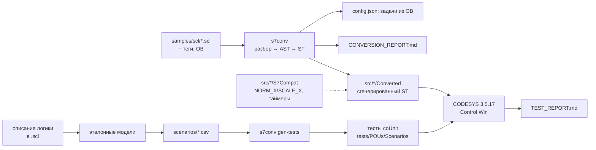

# s7-to-codesys

[](https://github.com/<GITHUB_USER>/s7-to-codesys/actions/workflows/ci.yml)

Миграция программ Siemens S7 (SCL, TIA Portal) на CODESYS V3.5: конвертер `s7conv` переводит
исходники SCL в ST CODESYS с отчётом о ручной работе, а тесты по сценариям проверяют, что поведение
блоков сохранилось. Конвертер не обещает «миграцию в один клик»: всё, что нельзя перевести однозначно,
остаётся в коде пометкой с причиной, а методика описывает, что делать с остальным.

## Демонстрация

> _Плейсхолдер: GIF «build-corpus → сборка в CODESYS → тесты сценариев в Control Win» появится после
> первого прогона в CODESYS._

На корпусе `samples/scl/` (20 файлов, 44 блока: ФБ, FC, OB, глобальные и экземплярные DB, UDT — вымышленная
водопроводная станция) — 998 конструкций: **94 %** переведены автоматически, **3 %** — с пометкой
`MIGRATION-CHECK`, **3 %** не поддерживаются (`MIGRATION-TODO`). Подробно по файлам и правилам —
[docs/CONVERSION_REPORT.md](docs/CONVERSION_REPORT.md).

## Архитектура



- **Разбор** — рукописный рекурсивный спуск с восстановлением после ошибок
  ([docs/GRAMMAR.md](docs/GRAMMAR.md)); **соответствия** S7 → CODESYS — [docs/MAPPING.md](docs/MAPPING.md).
- **Перенос один к одному**: имена, числа и структура исходника сохраняются, чтобы код сверялся с SCL, а
  теги HMI/SCADA — по именам. Глобальный DB → GVL с тем же именем, экземплярные DB → `GVL_InstanceDBs`,
  OB → программы и задачи, `%I/%Q/%M` → слой ввода-вывода с пересчитанными адресами.
- **Слой совместимости S7Compat** — рукописные `F_NormX`/`F_ScaleX` (семантика NORM_X/SCALE_X) и таймеры
  `FB_S7Ton/Tof/Tp` с подменяемым источником времени: тесты ставят часы на момент строки сценария и
  проверяют поведение ровно на пороге таймера за один цикл ПЛК.
- **Проверка поведения** — сценарии CSV для 6 блоков посчитаны эталонными моделями по описанию логики, а
  не по результату конвертера; генератор строит из них наборы coUnit для сконвертированного кода.

Подробно — [docs/ARCHITECTURE.md](docs/ARCHITECTURE.md), методика миграции и выбор способа тестирования —
[docs/methodology.md](docs/methodology.md).

## Быстрый старт без железа

Нужен Python 3.11+ (в CI — 3.12). CODESYS не нужен.

```bash
python -m pip install -r requirements-dev.txt

python -m s7conv check samples/scl                    # разбор: ошибки со строками
python -m s7conv convert samples/scl --out build/converted --emit-support \
       --report-html build/report.html                # перевод в раскладку + отчёт HTML
python -m s7conv build-corpus --check                 # закоммиченный результат воспроизводится
python -m s7conv --help                               # все команды и параметры

python -m pytest                                      # тесты конвертера, генератора, настроек
python tools/check/st_lint.py --strict                # линтер ST
python tools_project/iec_checker_gate.py              # статанализ (iec_checker v0.4: --binary или IEC_CHECKER)
python tools/check/run_rusty.py                       # необязательно: RuSTy plc --check
```

`s7conv convert` пишет раскладку `src/{DUTs,GVLs,POUs}/...` и `tasks.json`; таблицы тегов `*.csv` и
`ob_config.json` во входном каталоге подхватываются сами. `--timers s7compat` и `--f-trig s7compat`
включают объекты S7Compat вместо TON/TOF/TP и F_TRIG Standard. После `python -m pip install -e .`
доступна команда `s7conv`.

**Корпус в репозитории** собирается одной командой — `python -m s7conv build-corpus`: код в папку проекта
`Converted`, отчёт, задачи в `tools/codesys/config.json`, тесты сценариев и `PRG_Tests`. CI проверяет
`--check`: сгенерированное не правится руками и всегда совпадает с конвертером.

## CODESYS

Нужны CODESYS 3.5.17.30, CODESYS Control Win V3 и coUnit 1.2.0.0 ([docs/MANUAL_STEPS.md](docs/MANUAL_STEPS.md)).

```bat
python tools\codesys\cds.py build    :: импорт src/ и сборка рабочего проекта
python tools\codesys\cds.py test     :: тестовый проект, Control Win, тесты coUnit
python tools\codesys\cds.py report   :: итог в docs/TEST_REPORT.md
```

## Тесты и проверки

| Проверка | Где | Что |
|---|---|---|
| ruff, mypy (strict), pytest | CI | разбор, эмиттер, генератор тестов; снапшоты фикстур; снапшот корпуса — `build-corpus` воспроизводит закоммиченное побайтно; RuSTy по всему `src/` и `tests/` |
| `s7conv build-corpus --check` | CI | `src/*/Converted`, отчёт, задачи и тесты сценариев актуальны |
| `st_lint --strict` | CI | раскладка и оформление; с `Converted` сняты только правила именования и «магических чисел» |
| iec_checker 0.4 | CI, обязательно (через `tools_project/iec_checker_gate.py`) | статанализ; находки и пробелы разборщика — [docs/STATIC_ANALYSIS.md](docs/STATIC_ANALYSIS.md) |
| RuSTy `plc --check` | CI, необязательно | синтаксис и типы; исключения — с причинами |
| coUnit в Control Win | Windows, `cds.py test` | 13 наборов, 73 теста: слой S7Compat и 39 сценариев поведения — [docs/TEST_REPORT.md](docs/TEST_REPORT.md) |
| те же тесты в интерпретаторе ST | CI (pytest), без CODESYS | предварительная проверка: сгенерированные тесты против сконвертированного кода, мутации логики ловятся |

## Документация

- [methodology.md](docs/methodology.md) — этапы миграции, риски (время цикла, приоритеты OB, retain,
  аналоги, HMI, SCADA), чек-лист, оценка трудоёмкости, выбор способа тестирования
- [MAPPING.md](docs/MAPPING.md), [GRAMMAR.md](docs/GRAMMAR.md), [CONVERSION_REPORT.md](docs/CONVERSION_REPORT.md) —
  таблица соответствий, подмножество SCL, отчёт по корпусу
- [scenarios/README.md](scenarios/README.md) — формат сценариев и эталонные модели
- [ARCHITECTURE.md](docs/ARCHITECTURE.md), [LAYOUT.md](docs/LAYOUT.md) — устройство проекта и раскладка ST
- [STATIC_ANALYSIS.md](docs/STATIC_ANALYSIS.md), [TEST_REPORT.md](docs/TEST_REPORT.md) — отчёты проверок
- [ASSUMPTIONS.md](docs/ASSUMPTIONS.md), [MANUAL_STEPS.md](docs/MANUAL_STEPS.md) — допущения и ручные шаги

## Ограничения и дальнейшие шаги

- **В CODESYS ещё не собиралось и не тестировалось** — «проверено в CODESYS» появится в
  [TEST_REPORT.md](docs/TEST_REPORT.md) только после реального прогона. Синтаксис и типы проверены RuSTy,
  статанализ — iec_checker.
- Разбирается только SCL: блоки LAD/FBD/STL нужно сначала перевести в SCL в TIA Portal или вручную.
- Не переводятся системные функции (`RD_SYS_T`, `RUNTIME`, `PEEK`/`POKE`), `Variant`/`Any`, `AT`-наложения,
  `GOTO`, прямой доступ к периферии, событийные OB — они и есть основная ручная работа; доля конструкций
  в отчёте не равна доле труда ([methodology.md](docs/methodology.md), «Оценка трудоёмкости»).
- Корпус написан по формату внешних источников TIA Portal и в TIA не компилировался; поведение F_TRIG
  CODESYS Standard на первом вызове проверит первый прогон тестов.
- Слой ввода-вывода — заготовка: каналы ПЛК210 привязываются в дереве устройств.
- Часть расхождений S7 и CODESYS зависит от данных во время работы, и конвертер их не помечает:
  разрядность промежуточных результатов целой арифметики, индекс массива вне границ, деление REAL на 0,
  неявные преобразования типов ([MAPPING.md](docs/MAPPING.md), «Расхождения, которые конвертер не
  помечает»). OB100 эмулируется флагом первого цикла, который команда Stop → Start CODESYS не сбрасывает.

## Summary (EN)

s7-to-codesys is a partial, honest converter from Siemens S7 SCL (TIA Portal external sources) to
CODESYS V3.5 Structured Text, plus a migration methodology. The hand-written recursive-descent parser
handles a 20-file SCL corpus (44 blocks); 94 % of constructs convert automatically, everything else is
left in the code as `MIGRATION-CHECK`/`MIGRATION-TODO` markers and counted in a per-file report.
Behaviour is verified with coUnit test suites generated from CSV scenarios whose expected values come
from reference models of the block descriptions, not from the converter output; timers use an
injectable clock so threshold rows are checked deterministically. CI checks Python (ruff, mypy, pytest),
ST (linter, iec_checker, RuSTy) and that the committed converted code is reproducible. The CODESYS build
and test run are the next step. Documentation is in Russian.

## Лицензия

[MIT](LICENSE) © 2026 <ИМЯ ФАМИЛИЯ>
