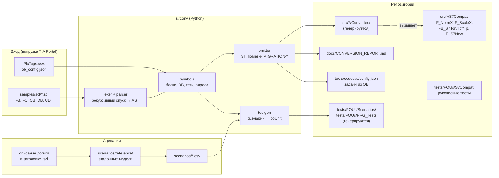

# Архитектура

Проект — конвертер `s7conv` (Python) и его результат: сконвертированный корпус SCL в раскладке ST
CODESYS ([LAYOUT.md](LAYOUT.md)), слой совместимости S7Compat и тесты поведения по сценариям. Источник
истины — тексты: корпус `samples/scl/`, сценарии `scenarios/*.csv`, рукописный ST и код конвертера;
всё сгенерированное воспроизводится командой `python -m s7conv build-corpus` и проверяется в CI.

## Поток данных

| Модуль `s7conv/` | Роль |
|---|---|
| `lexer.py`, `parser.py`, `nodes.py` | разбор SCL TIA Portal в AST с восстановлением после ошибок ([GRAMMAR.md](GRAMMAR.md)) |
| `symbols.py` | таблица символов корпуса, модель адресов S7 → CODESYS, таблица тегов |
| `mapping.py` | таблицы соответствий: типы, ФБ инструкций, функции, литералы, имена; режимы таймеров и F_TRIG; объекты S7Compat и их зависимости ([MAPPING.md](MAPPING.md)) |
| `emitter.py` | генерация объектов раскладки через `tools/codesys/stlayout.py`, вывод типов, пометки и статусы |
| `tasks.py` | OB → задачи CODESYS |
| `report.py` | отчёт Markdown и HTML |
| `testgen.py` | чтение сценариев CSV, сопоставление имён по таблицам конвертера, наборы coUnit, `PRG_Tests` |
| `corpus.py` | `build-corpus`: корпус → `src/*/Converted`, отчёт, задачи в `config.json`, тесты; `--check` |
| `pipeline.py`, `cli.py` | входные файлы, запись раскладки; команды `convert`, `report`, `check`, `build-corpus`, `gen-tests` |

## Проект CODESYS

| Папка проекта | Каталог | Что |
|---|---|---|
| `Converted` | `src/DUTs/Converted`, `src/GVLs/Converted`, `src/POUs/Converted` | сконвертированный корпус: 7 DUT, 6 GVL (`DB_Plant`, `DB_Hmi`, `DB_Telegram`, `GVL_InstanceDBs`, `GVL_IO`, `GVL_Markers`), 14 ФБ, 1 функция, 4 программы из OB |
| `S7Compat` | `src/POUs/S7Compat`, `src/GVLs/S7Compat` | рукописный слой совместимости ([MAPPING.md](MAPPING.md), «Слой совместимости S7Compat») |
| `Tests/S7Compat` | `tests/POUs/S7Compat` | юнит-тесты слоя совместимости, в том числе сверка таймеров со Standard в реальном времени |
| `Tests/Scenarios` | `tests/POUs/Scenarios` | тесты поведения сконвертированных блоков по сценариям CSV |
| `Tests` | `tests/POUs/PRG_Tests` | программа запуска тестов |

Задачи рабочего проекта (`tools/codesys/config.json`, режим `normal`) — из OB корпуса: `MainTask`
10 мс (`PRG_Startup`, `PRG_Main`) и `Task_OB30` 100 мс (`PRG_Cyclic_interrupt`); тестовый проект
(режим `test`) — `TestTask` 10 мс → `PRG_Tests` и библиотека coUnit. Импорт, сборка и прогон тестов —
`python tools/codesys/cds.py import | build | test` ([MANUAL_STEPS.md](MANUAL_STEPS.md)).

## Контуры проверок

| Контур | Где | Что ловит |
|---|---|---|
| Python | CI и локально: ruff, mypy, pytest | разбор, эмиттер, генератор тестов, снапшот корпуса (`build-corpus` воспроизводит закоммиченное побайтно), RuSTy по всему `src/` и `tests/`; наборы coUnit, исполненные интерпретатором ST (`s7conv/tests/stsim.py`) против закоммиченного кода, и мутации логики |
| ST без CODESYS | CI и локально: `st_lint`, `assemble.py`, iec_checker (через `tools_project/iec_checker_gate.py`), RuSTy | раскладка, оформление, синтаксис и типы, статанализ ([STATIC_ANALYSIS.md](STATIC_ANALYSIS.md)) |
| CODESYS | Windows, CODESYS 3.5.17.30 и Control Win V3 | компиляция CODESYS, тесты coUnit ([TEST_REPORT.md](TEST_REPORT.md)) |

## Каталоги

| Каталог | Содержимое |
|---|---|
| `s7conv/` | конвертер и его тесты (`s7conv/tests`, снапшоты фикстур) |
| `samples/scl/` | корпус SCL (20 файлов, 44 блока), таблица тегов, `ob_config.json`, матрица покрытия |
| `scenarios/` | сценарии CSV, эталонные модели и их тесты (`scenarios/reference`) |
| `src/`, `tests/` | раскладка ST: сгенерированное и рукописное (таблица выше) |
| `tools/` | инструменты шаблона: `assemble.py`, `check/` (линтер, iec_checker, RuSTy), `codesys/` (CODESYS из консоли) |
| `tools_project/` | проверки репозитория проекта: обёртка iec_checker, тесты настроек |
| `docs/` | документация и отчёты |
| `build/` | артефакты сборки и проверок, в git не хранится |
